# E5 · Compresión uSID y migración desde SIDs clásicos

> **El caso en una frase**: un operador con SRv6 clásico quiere pasar a **uSID** para que sus caminos de ingeniería de tráfico quepan en una sola dirección IPv6, sin SRH, y necesita hacerlo **router a router**, sin cortar los servicios que ya tiene.
>
> **Requisitos previos**: módulos [10](../../10-usid/README.md) (uSID), [11](../../11-isis-srv6/README.md) (IS-IS con SRv6), [13](../../13-l3vpn-dualstack/README.md) (L3VPN dual-stack) y [14](../../14-te-srv6/README.md) (ingeniería de tráfico), y el escenario [E1](../E1-multisede/README.md) · Probado con containerlab 0.82.0 sobre OrbStack, FRR 10.7.1 y netshoot v0.13 · Estado: ✅

## El escenario

El escenario tiene **dos laboratorios** sobre la topología base, con el mismo servicio (una L3VPN dual-stack entre BLUE-1 y BLUE-2):

| Laboratorio | Qué hay | Carpeta |
|---|---|---|
| **Parte 1** · red uSID | Los seis routers con locators uSID: transporte comprimido y SID de servicio comprimido | [`lab-usid/`](lab-usid) |
| **Parte 2** · red a medio migrar | r1, r2 y r3 ya migrados a uSID; r4, r5 y r6 siguen con SIDs clásicos | [`lab-migracion/`](lab-migracion) |

## 1. El caso de uso

El operador AS 64500 lleva tiempo con SRv6 clásico: L3VPN para sus clientes y algunos caminos de ingeniería de tráfico con rutas estáticas con segmentos, como en E1. Dos cosas le preocupan:

- **El tamaño de la cabecera.** Cada SID clásico ocupa 16 bytes. Un camino de TE con cuatro segmentos añade una SRH de 8 + 4·16 = **72 bytes**, además de los 40 de la cabecera IPv6 exterior. En enlaces con MTU justa (módulo 18) eso obliga a fragmentar o a subir la MTU de todo el núcleo, y algunos equipos de su red no procesan bien SRH largas.
- **La migración.** Tiene cientos de routers y no puede cambiarlos todos en una noche. Necesita que la red funcione **mientras conviven** routers con uSID y routers con SIDs clásicos, y saber qué puede hacer y qué no durante la transición.

## 2. Criterios de éxito

**Parte 1** (`lab-usid/verificar.sh`):

- [ ] **1.** IS-IS instala en cada router su **uN** (un `End` con el flavor `next-csid` para todo su locator) y sus **uA** (`End.X` con `next-csid`).
- [ ] **2.** Los PE (r1 y r6) tienen un **uDT46** para la VRF BLUE, que el kernel ve como `End.DT46` con la tabla 10.
- [ ] **3.** La L3VPN dual-stack funciona en los dos sentidos, y en el núcleo los paquetes viajan **sin SRH** (`H.Encaps.Red` con un solo SID).
- [ ] **4.** (TE) Un camino por r3 y r5 cabe en **una sola dirección**: el contenedor `5f00:0:5:6:…`. r5 **desplaza** su uSID y el paquete llega a r6 con el SID de servicio de r6 como destino.

**Parte 2** (`lab-migracion/verificar.sh`):

- [ ] **1.** Conviven los dos tipos: r1, r2 y r3 instalan uN; r4, r5 y r6, `End` clásicos. IS-IS converge igual.
- [ ] **2.** r1 tiene un **uDT46** y r6 un **`End.DT46` clásico**, cada uno el suyo.
- [ ] **3.** La L3VPN dual-stack funciona entre un PE uSID y un PE clásico, sin SRH.
- [ ] **4.** (TE) Una lista que **mezcla** un uSID (r3) con SIDs clásicos (r5 y r6) funciona.

## 3. La solución con SRv6

### Parte 1: toda la red con uSID

```mermaid
graph LR
    h1("🖥️ <b>h1</b><br/>PC1 · sede BLUE-1<br/>eth1: 192.168.10.12/24, 3fff:168:10::12/64")
    h11("🖥️ <b>h11</b><br/>PC11 · VLAN 100 (no se usa en E5)<br/>eth1: 192.168.100.11/24, 3fff:168:100::11/64")
    sw1("<b>sw1</b><br/>switch · VLAN 100 (no se usa en E5)")
    r1("<b>r1</b><br/>PE1 · uSID<br/>lo: 3fff:0:ff::1/128<br/>eth1: 3fff:0:12::1/64 (m=10)<br/>eth2: 3fff:0:13::1/64 (m=15)<br/>eth3: 192.168.10.1/24, 3fff:168:10::1/64 (VRF BLUE)<br/>locator 5f00:0:1::/48 (uSID)<br/>SID uN 5f00:0:1::/48 · uA por adyacencia · uDT46 (VRF BLUE)")
    r2("<b>r2</b><br/>P · uSID<br/>lo: 3fff:0:ff::2/128<br/>eth1: 3fff:0:12::2/64 (m=10)<br/>eth2: 3fff:0:23::2/64 (m=10)<br/>eth3: 3fff:0:24::2/64 (m=10)<br/>eth4: 3fff:0:25::2/64 (m=25)<br/>locator 5f00:0:2::/48 (uSID)<br/>SID uN 5f00:0:2::/48 · uA por adyacencia")
    r3("<b>r3</b><br/>P · uSID<br/>lo: 3fff:0:ff::3/128<br/>eth1: 3fff:0:13::3/64 (m=15)<br/>eth2: 3fff:0:23::3/64 (m=10)<br/>eth3: 3fff:0:35::3/64 (m=10)<br/>eth4: 3fff:0:34::3/64 (m=25)<br/>locator 5f00:0:3::/48 (uSID)<br/>SID uN 5f00:0:3::/48 · uA por adyacencia")
    r4("<b>r4</b><br/>P · uSID<br/>lo: 3fff:0:ff::4/128<br/>eth1: 3fff:0:24::4/64 (m=10)<br/>eth2: 3fff:0:45::4/64 (m=15)<br/>eth3: 3fff:0:46::4/64 (m=10)<br/>eth4: 3fff:0:34::4/64 (m=25)<br/>locator 5f00:0:4::/48 (uSID)<br/>SID uN 5f00:0:4::/48 · uA por adyacencia")
    r5("<b>r5</b><br/>P · uSID<br/>lo: 3fff:0:ff::5/128<br/>eth1: 3fff:0:35::5/64 (m=10)<br/>eth2: 3fff:0:45::5/64 (m=15)<br/>eth3: 3fff:0:56::5/64 (m=10)<br/>eth4: 3fff:0:25::5/64 (m=25)<br/>locator 5f00:0:5::/48 (uSID)<br/>SID uN 5f00:0:5::/48 · uA por adyacencia")
    r6("<b>r6</b><br/>PE2 · uSID<br/>lo: 3fff:0:ff::6/128<br/>eth1: 3fff:0:46::6/64 (m=10)<br/>eth2: 3fff:0:56::6/64 (m=10)<br/>eth3: 192.168.20.1/24, 3fff:168:20::1/64 (VRF BLUE)<br/>locator 5f00:0:6::/48 (uSID)<br/>SID uN 5f00:0:6::/48 · uA por adyacencia · uDT46 (VRF BLUE)")
    sw2("<b>sw2</b><br/>switch · VLAN 100 (no se usa en E5)")
    h2("🖥️ <b>h2</b><br/>PC2 · sede BLUE-2<br/>eth1: 192.168.20.12/24, 3fff:168:20::12/64")
    h12("🖥️ <b>h12</b><br/>PC12 · VLAN 100 (no se usa en E5)<br/>eth1: 192.168.100.12/24, 3fff:168:100::12/64")

    r1 -- "eth1 ⟷ eth1<br/>3fff:0:12::/64 · m=10" --- r2
    r1 -- "eth2 ⟷ eth1<br/>3fff:0:13::/64 · m=15" --- r3
    r2 -- "eth2 ⟷ eth2<br/>3fff:0:23::/64 · m=10" --- r3
    r2 -- "eth3 ⟷ eth1<br/>3fff:0:24::/64 · m=10" --- r4
    r2 -- "eth4 ⟷ eth4<br/>3fff:0:25::/64 · m=25" --- r5
    r3 -- "eth3 ⟷ eth1<br/>3fff:0:35::/64 · m=10" --- r5
    r3 -- "eth4 ⟷ eth4<br/>3fff:0:34::/64 · m=25" --- r4
    r4 -- "eth2 ⟷ eth2<br/>3fff:0:45::/64 · m=15" --- r5
    r4 -- "eth3 ⟷ eth1<br/>3fff:0:46::/64 · m=10" --- r6
    r5 -- "eth3 ⟷ eth2<br/>3fff:0:56::/64 · m=10" --- r6
    h1 -- "eth1 ⟷ eth3<br/>192.168.10.0/24" --- r1
    sw1 -- "eth1 ⟷ eth4" --- r1
    h11 -- "eth1 ⟷ eth2<br/>192.168.100.0/24" --- sw1
    r6 -- "eth3 ⟷ eth1<br/>192.168.20.0/24" --- h2
    r6 -- "eth4 ⟷ eth1" --- sw2
    sw2 -- "eth2 ⟷ eth1<br/>192.168.100.0/24" --- h12

    classDef router fill:#ddf4ff,stroke:#0969da,stroke-width:2px,color:#1f2328
    classDef host fill:#dafbe1,stroke:#1a7f37,stroke-width:2px,color:#1f2328
    classDef switch fill:#f6f8fa,stroke:#57606a,stroke-width:2px,color:#1f2328
    class r1,r2,r3,r4,r5,r6 router
    class h1,h11,h2,h12 host
    class sw1,sw2 switch
```

<!-- topologia:inicio lab-usid -->

<!-- topologia:fin lab-usid -->

> El fichero editable para draw.io está en [`lab-usid/topologia.drawio`](lab-usid/topologia.drawio).

En el módulo 10 montaste los uSID a mano, con `ip -6 route` en cada router. Aquí los monta **FRR**, y basta con una línea en el locator:

```
segment-routing
 srv6
  locators
   locator MAIN
    prefix 5f00:0:1::/48 block-len 32 node-len 16 func-bits 16
    behavior usid
```

Con `behavior usid`, el locator usa el formato **F3216** (bloque de 32 bits, uSID de 16) y cambia lo que asigna cada protocolo:

| Quién | SID clásico | Con `behavior usid` | En el kernel |
|---|---|---|---|
| IS-IS, el nodo | `End` (`5f00:0:1::/128`) | **uN** (`5f00:0:1::/48`) | `End flavors next-csid` |
| IS-IS, cada adyacencia | `End.X` | **uA** | `End.X flavors next-csid` |
| BGP, la VRF | `End.DT46` | **uDT46** | `End.DT46` |

- **uN cubre todo el locator** (`/48`), no una sola dirección: así procesa cualquier contenedor en el que su uSID (`0001`, `0002`…) sea el activo, sea cual sea lo que venga detrás.
- **uDT46** es el SID de servicio comprimido. En el cable es un uSID más (`5f00:0:6:XXXX::`, con la función en los 16 bits que siguen al nodo), y el kernel lo ejecuta como un `End.DT46` normal: al ser el último uSID del contenedor, no hay nada que desplazar.

Lo demás es la L3VPN dual-stack del módulo 13: iBGP entre r1 y r6 con VPNv4 y VPNv6, un SID por VRF (`sid vpn per-vrf export auto`) y `encap-behavior H_Encaps_Red`, para que con un solo SID el paquete no lleve SRH.

### Parte 2: una red a medio migrar

```mermaid
graph LR
    h1("🖥️ <b>h1</b><br/>PC1 · sede BLUE-1<br/>eth1: 192.168.10.12/24, 3fff:168:10::12/64")
    h11("🖥️ <b>h11</b><br/>PC11 · VLAN 100 (no se usa en E5)<br/>eth1: 192.168.100.11/24, 3fff:168:100::11/64")
    sw1("<b>sw1</b><br/>switch · VLAN 100 (no se usa en E5)")
    r1("<b>r1</b><br/>PE1 · uSID<br/>lo: 3fff:0:ff::1/128<br/>eth1: 3fff:0:12::1/64 (m=10)<br/>eth2: 3fff:0:13::1/64 (m=15)<br/>eth3: 192.168.10.1/24, 3fff:168:10::1/64 (VRF BLUE)<br/>locator 5f00:0:1::/48 (uSID)<br/>SID uN 5f00:0:1::/48 · uA por adyacencia · uDT46 (VRF BLUE)")
    r2("<b>r2</b><br/>P · uSID<br/>lo: 3fff:0:ff::2/128<br/>eth1: 3fff:0:12::2/64 (m=10)<br/>eth2: 3fff:0:23::2/64 (m=10)<br/>eth3: 3fff:0:24::2/64 (m=10)<br/>eth4: 3fff:0:25::2/64 (m=25)<br/>locator 5f00:0:2::/48 (uSID)<br/>SID uN 5f00:0:2::/48 · uA por adyacencia")
    r3("<b>r3</b><br/>P · uSID<br/>lo: 3fff:0:ff::3/128<br/>eth1: 3fff:0:13::3/64 (m=15)<br/>eth2: 3fff:0:23::3/64 (m=10)<br/>eth3: 3fff:0:35::3/64 (m=10)<br/>eth4: 3fff:0:34::3/64 (m=25)<br/>locator 5f00:0:3::/48 (uSID)<br/>SID uN 5f00:0:3::/48 · uA por adyacencia")
    r4("<b>r4</b><br/>P · clásico<br/>lo: 3fff:0:ff::4/128<br/>eth1: 3fff:0:24::4/64 (m=10)<br/>eth2: 3fff:0:45::4/64 (m=15)<br/>eth3: 3fff:0:46::4/64 (m=10)<br/>eth4: 3fff:0:34::4/64 (m=25)<br/>locator 5f00:0:4::/48 (clásico)<br/>SID End/End.X clásicos")
    r5("<b>r5</b><br/>P · clásico<br/>lo: 3fff:0:ff::5/128<br/>eth1: 3fff:0:35::5/64 (m=10)<br/>eth2: 3fff:0:45::5/64 (m=15)<br/>eth3: 3fff:0:56::5/64 (m=10)<br/>eth4: 3fff:0:25::5/64 (m=25)<br/>locator 5f00:0:5::/48 (clásico)<br/>SID End/End.X clásicos")
    r6("<b>r6</b><br/>PE2 · clásico<br/>lo: 3fff:0:ff::6/128<br/>eth1: 3fff:0:46::6/64 (m=10)<br/>eth2: 3fff:0:56::6/64 (m=10)<br/>eth3: 192.168.20.1/24, 3fff:168:20::1/64 (VRF BLUE)<br/>locator 5f00:0:6::/48 (clásico)<br/>SID End/End.X clásicos · End.DT46 (VRF BLUE)")
    sw2("<b>sw2</b><br/>switch · VLAN 100 (no se usa en E5)")
    h2("🖥️ <b>h2</b><br/>PC2 · sede BLUE-2<br/>eth1: 192.168.20.12/24, 3fff:168:20::12/64")
    h12("🖥️ <b>h12</b><br/>PC12 · VLAN 100 (no se usa en E5)<br/>eth1: 192.168.100.12/24, 3fff:168:100::12/64")

    r1 -- "eth1 ⟷ eth1<br/>3fff:0:12::/64 · m=10" --- r2
    r1 -- "eth2 ⟷ eth1<br/>3fff:0:13::/64 · m=15" --- r3
    r2 -- "eth2 ⟷ eth2<br/>3fff:0:23::/64 · m=10" --- r3
    r2 -- "eth3 ⟷ eth1<br/>3fff:0:24::/64 · m=10" --- r4
    r2 -- "eth4 ⟷ eth4<br/>3fff:0:25::/64 · m=25" --- r5
    r3 -- "eth3 ⟷ eth1<br/>3fff:0:35::/64 · m=10" --- r5
    r3 -- "eth4 ⟷ eth4<br/>3fff:0:34::/64 · m=25" --- r4
    r4 -- "eth2 ⟷ eth2<br/>3fff:0:45::/64 · m=15" --- r5
    r4 -- "eth3 ⟷ eth1<br/>3fff:0:46::/64 · m=10" --- r6
    r5 -- "eth3 ⟷ eth2<br/>3fff:0:56::/64 · m=10" --- r6
    h1 -- "eth1 ⟷ eth3<br/>192.168.10.0/24" --- r1
    sw1 -- "eth1 ⟷ eth4" --- r1
    h11 -- "eth1 ⟷ eth2<br/>192.168.100.0/24" --- sw1
    r6 -- "eth3 ⟷ eth1<br/>192.168.20.0/24" --- h2
    r6 -- "eth4 ⟷ eth1" --- sw2
    sw2 -- "eth2 ⟷ eth1<br/>192.168.100.0/24" --- h12

    classDef router fill:#ddf4ff,stroke:#0969da,stroke-width:2px,color:#1f2328
    classDef host fill:#dafbe1,stroke:#1a7f37,stroke-width:2px,color:#1f2328
    classDef switch fill:#f6f8fa,stroke:#57606a,stroke-width:2px,color:#1f2328
    class r1,r2,r3,r4,r5,r6 router
    class h1,h11,h2,h12 host
    class sw1,sw2 switch
```

<!-- topologia:inicio lab-migracion -->

<!-- topologia:fin lab-migracion -->

> El fichero editable para draw.io está en [`lab-migracion/topologia.drawio`](lab-migracion/topologia.drawio).

La mitad izquierda de la red (r1, r2, r3) ya tiene `behavior usid`. La derecha (r4, r5, r6) aún no. **Todo sigue funcionando**, y la razón es sencilla: para los routers de tránsito, un SID es **una dirección IPv6 más**. r2 y r4 reenvían un paquete hacia `5f00:0:6:…` por la ruta del locator de r6, sin saber si es un SID clásico o un uSID. Solo el router **dueño** del SID tiene que entenderlo, y cada uno entiende los suyos.

- **BE (sin TE)**: r1 encapsula hacia el `End.DT46` **clásico** de r6, y r6 hacia el **uDT46** de r1. Ningún router necesita saber qué tipo de SID usa el otro: BGP le da el SID y basta con encapsular hacia él.
- **TE**: r1 puede construir listas que **mezclan** uSID y SIDs clásicos, siempre que respete una regla: **un contenedor solo puede llevar uSID de routers que entienden uN**. Un router clásico solo aparece en la lista como un SID clásico entero.

## 4. Decisiones de diseño

| Decisión | Por qué | Alternativa descartada |
|---|---|---|
| Formato **F3216** | Es el más extendido: caben 6 uSID en una dirección y deja 16 bits de función por nodo | F3224 o F4816: más nodos o más funciones por nodo, pero menos uSID por contenedor |
| **El mismo prefijo** de locator (`5f00:0:N::/48`) en las dos partes | Permite comparar la parte 1 y la 2 sin cambiar el plan de direcciones | Un bloque nuevo para uSID: lo habitual en producción (sección 9), pero aquí añadiría otro direccionamiento |
| **uDT46** por VRF | Un solo SID para IPv4 e IPv6, como en el módulo 13 | `uDT4` y `uDT6` por familia: dos SIDs donde basta uno |
| **`H_Encaps_Red`** en BGP | Con un solo SID, la dirección de destino lo lleva todo: sin SRH | `H_Encaps`: añadiría una SRH de un segmento que no aporta nada |
| TE con **estáticas con segmentos** | FRR no tiene SR Policy para SRv6 (módulo 14). Una estática con un contenedor es lo más parecido | SR Policy con listas de uSID: la forma de producto |
| Migrar **primero un extremo** (r1, r2, r3) | Muestra los dos casos a la vez: PE uSID con PE clásico y caminos mixtos | Migrar primero los P y después los PE: lo habitual (sección 9), pero con los dos PE clásicos no hay uDT46 que mostrar |

## 5. Primero, por el camino más corto

En las dos partes, sin TE, el tráfico de BLUE-1 a BLUE-2 sigue el camino más corto de IS-IS (r1 → r2 → r4 → r6) con **un solo SID** en la dirección de destino: el SID de servicio de r6. En la ruta BGP de r1:

```
$ docker exec clab-esc-e5-usid-r1 ip route show vrf BLUE 192.168.20.0/24
192.168.20.0/24 nhid … encap seg6 mode encap.red segs 1 [ 5f00:0:6:XXXX:: ] via inet6 fe80::… dev eth1 …
```

Es lo mismo que con SIDs clásicos. **Con un solo SID, uSID no ahorra nada**: el paquete ya viajaba sin SRH gracias a `H.Encaps.Red`. La ganancia aparece cuando hay **varios** SIDs, es decir, con ingeniería de tráfico.

## 6. Después, con ingeniería de tráfico

### Parte 1: el camino entero en un contenedor

El cliente quiere que el tráfico hacia BLUE-2 vaya por abajo: r1 → r3 → r5 → r6. Con SIDs clásicos (E1) eso eran **dos** SIDs (`End` de r5 y el SID de servicio de r6) y una SRH. Con uSID, los dos caben en **una sola dirección**:

```
5f00:0000 : 0005 : 0006 : XXXX : 0000 : 0000 : 0000
 bloque     uN r5  uN r6  función de r6 (uDT46)
```

Es decir: el SID de servicio de r6, `5f00:0:6:XXXX::`, con el uSID de r5 (`0005`) **insertado delante**. En r1, dentro de la VRF BLUE:

```
vrf BLUE
 ip route 192.168.20.0/24 3fff:0:13::3 eth2 nexthop-vrf default segments 5f00:0:5:6:XXXX:: encap-behavior H_Encaps_Red
exit-vrf
```

Lo que ocurre en cada salto:

| Router | Destino del paquete | Qué hace |
|---|---|---|
| r1 | — | Encapsula: destino `5f00:0:5:6:XXXX::`, sin SRH |
| r3 | `5f00:0:5:6:XXXX::` | Lo reenvía por la ruta del locator de r5 (`5f00:0:5::/48`): es tránsito, no lo procesa |
| r5 | `5f00:0:5:6:XXXX::` | Su **uN** coincide (`0005` activo): **desplaza** el resto 16 bits a la izquierda. Nuevo destino: `5f00:0:6:XXXX::` |
| r6 | `5f00:0:6:XXXX::` | Su **uDT46** coincide: desencapsula y busca en la tabla de BLUE |

Fíjate en que **uN no es un `End` con otro nombre**: un `End` clásico necesita una SRH para saber cuál es el siguiente segmento. uN no: el siguiente segmento ya está **dentro de la dirección**.

### Parte 2: listas mixtas

Con r5 y r6 clásicos, el contenedor anterior **no funciona**: r5 no sabe desplazar. Pero r1 puede seguir haciendo TE con una lista de SIDs con SRH, y usar uSID donde pueda:

```
vrf BLUE
 ip route 192.168.20.0/24 3fff:0:13::3 eth2 nexthop-vrf default segments 5f00:0:3::/5f00:0:5::/SID-de-r6
exit-vrf
```

- **`5f00:0:3::`**: el uN de r3, en un contenedor de un solo uSID. Cuando r3 lo procesa, ve que no queda nada detrás de su uSID y se comporta como un `End` clásico: pasa al siguiente segmento de la SRH.
- **`5f00:0:5::`**: el `End` clásico de r5.
- **El SID de r6**: su `End.DT46` clásico.

Aquí uSID no ahorra cabecera: los tres SIDs ocupan 16 bytes cada uno. Pero demuestra lo importante para la migración: **un router uSID entiende listas clásicas**, así que los caminos de TE que ya existían siguen funcionando cuando se migra un router intermedio.

## 7. Lo que verás en el cable

- **Parte 1, sin TE**: en r2, un paquete con destino `5f00:0:6:XXXX::` y **Next Header 4** (IPv4 directamente dentro de IPv6, sin SRH). 40 bytes de sobrecarga.
- **Parte 1, con TE**: en el enlace r1–r3, el destino es `5f00:0:5:6:XXXX::`; en el enlace r5–r6, **el mismo paquete** lleva ya `5f00:0:6:XXXX::`. Es el desplazamiento de r5. Sigue sin SRH: 40 bytes, frente a los **72** (40 + SRH de 8 + 2·16) del mismo camino con SIDs clásicos.
- **Parte 2, con TE**: una SRH de **3** segmentos (Next Header 43). Entre r3 y r5 el destino ya es `5f00:0:5::`: r3 consumió su segmento. 40 + 8 + 3·16 = **96** bytes de sobrecarga.

## 8. Rómpelo y arréglalo

En la parte 2, mete el router clásico r5 **dentro de un contenedor**: `segments 5f00:0:5:3::/SID-de-r6` (primero r5, después r3). Parece un camino válido: los dos son routers de la red y los dos tienen SIDs. Pero r5 recibe un paquete con destino `5f00:0:5:3::`, que no coincide con su `End` (`5f00:0:5::/128`) ni con ningún otro SID suyo, y no sabe qué hacer con él. El tráfico se pierde **en r5**, y desde r1 todo parece correcto: la ruta está instalada y el primer salto responde. La práctica lo plantea paso a paso.

## 9. En producción

- **Un bloque nuevo para uSID.** Lo habitual es asignar un bloque distinto para los locators uSID (por ejemplo, un `/32` nuevo dentro de `5f00::/16`) y que cada router tenga, durante la migración, **dos locators**: el clásico para los servicios existentes y el uSID para los nuevos. Así nada cambia de dirección mientras se migra. En FRR, IS-IS y BGP usan cada uno el locator que se les asigna; el laboratorio reutiliza el mismo prefijo para no complicar el direccionamiento.
- **Orden de migración.** Primero los **P** (para que el núcleo entienda uN y uA y se puedan construir contenedores), después los **PE** (que pasan a anunciar uDT y uDX) y, por último, los caminos de TE, que se reescriben como contenedores. En cada paso, el controlador o la SR Policy solo deben meter en un contenedor los routers que ya lo soportan: BGP-LS anuncia qué behaviors y qué formato soporta cada nodo (escenario E7).
- **Islas SRv6 sobre GRE.** Si la migración es de una red **sin SRv6** a SRv6 y entre dos islas SRv6 queda un trozo de red que aún no la soporta, hay dos casos:
  - Si ese trozo enruta **IPv6**, no hace falta nada: los SIDs son direcciones IPv6 y se reenvían como cualquier otra, siempre que ese trozo conozca las rutas de los locators y no filtre el tráfico con SRH.
  - Si ese trozo es **solo IPv4**, se unen las islas con un **túnel GRE** (IPv6 sobre IPv4) entre los routers frontera, y IS-IS se levanta sobre el túnel como si fuera un enlace más. La MTU del túnel (24 bytes menos) se suma a la sobrecarga de SRv6: hay que tenerla en cuenta (módulo 18).
- **Interoperabilidad**: el formato (F3216 u otro) y la longitud del bloque deben ser **los mismos en todo el dominio**. Un router que espere un bloque de 32 bits no entiende un contenedor de un bloque de 48.

## 10. Resumen

- Con `behavior usid` en el locator, FRR asigna **uN** y **uA** en IS-IS y **uDT46** en BGP, en formato F3216. El kernel los instala como `End`/`End.X` con el flavor `next-csid` y un `End.DT46` normal.
- Con un solo SID, uSID no ahorra nada frente a `H.Encaps.Red`. La ganancia está en la **TE**: un camino de varios saltos cabe en **un contenedor**, sin SRH.
- **uN desplaza** su uSID: el siguiente segmento está en la propia dirección, no en una SRH.
- Una red **a medio migrar** funciona: el tránsito no distingue SIDs clásicos de uSID, y cada PE usa el SID que le da BGP. Las listas mixtas funcionan, pero **un contenedor solo puede llevar uSID de routers que soportan uN**.

## Para saber más

- [RFC 9800 · Compressed SRv6 Segment List Encoding (NEXT-C-SID)](https://www.rfc-editor.org/rfc/rfc9800) — uN, uA, uDT y el formato del contenedor
- [RFC 8986 · SRv6 Network Programming](https://www.rfc-editor.org/rfc/rfc8986) — los behaviors clásicos
- [FRR · SRv6](https://docs.frrouting.org/en/latest/zebra.html#segment-routing-ipv6) — locators y `behavior usid`
- [SRv6 uSID en el kernel de Linux (netdev 0x19, 2025)](https://www.segment-routing.net/images/20250311-srv6-usid-linux-netdev-0x19.pdf) — `next-csid` en `End` y `End.X`
