# E5 · Práctica: compresión uSID y migración

Antes de empezar, lee el [planteamiento del escenario](README.md). Los contenedores se llaman `clab-esc-e5-usid-…` (parte 1) y `clab-esc-e5-migracion-…` (parte 2).

## Parte A · Ejercicios en papel

**A1.** Con el formato F3216, ¿cuántos uSID caben en un contenedor? Escribe el contenedor que lleva un paquete por r1 → r2 → r3 → r5 → r6 forzando cada nodo con su uN, y terminando en el uDT46 de r6 (supón que su función es `e000`). ¿Haría falta SRH?

**A2.** Ese mismo camino con SIDs clásicos (`End` de r2, r3 y r5, y el `End.DT46` de r6): ¿cuántos bytes de sobrecarga lleva cada paquete? ¿Y con uSID?

**A3.** En una red a medio migrar, r5 es clásico. Un compañero propone el contenedor `5f00:0:3:5::` (r3 y luego r5) seguido del SID clásico de r6. ¿Funcionaría? Pista: ¿en qué dirección se convierte `5f00:0:3:5::` cuando r3 desplaza su uSID?

**A4.** Dos islas SRv6 están separadas por una red de otro departamento que solo enruta IPv6 y no sabe nada de SRv6. ¿Qué necesitas para que el tráfico SRv6 cruce de una a otra? ¿Y si esa red fuera solo IPv4?

## Parte B · Parte 1: una red uSID

```mermaid
graph LR
    h1("🖥️ <b>h1</b><br/>PC1 · sede BLUE-1<br/>eth1: 192.168.10.12/24, 3fff:168:10::12/64")
    h11("🖥️ <b>h11</b><br/>PC11 · VLAN 100 (no se usa en E5)<br/>eth1: 192.168.100.11/24, 3fff:168:100::11/64")
    sw1("<b>sw1</b><br/>switch · VLAN 100 (no se usa en E5)")
    r1("<b>r1</b><br/>PE1 · uSID<br/>lo: 3fff:0:ff::1/128<br/>eth1: 3fff:0:12::1/64 (m=10)<br/>eth2: 3fff:0:13::1/64 (m=15)<br/>eth3: 192.168.10.1/24, 3fff:168:10::1/64 (VRF BLUE)<br/>locator 5f00:0:1::/48 (uSID)<br/>SID uN 5f00:0:1::/48 · uA por adyacencia · uDT46 (VRF BLUE)")
    r2("<b>r2</b><br/>P · uSID<br/>lo: 3fff:0:ff::2/128<br/>eth1: 3fff:0:12::2/64 (m=10)<br/>eth2: 3fff:0:23::2/64 (m=10)<br/>eth3: 3fff:0:24::2/64 (m=10)<br/>eth4: 3fff:0:25::2/64 (m=25)<br/>locator 5f00:0:2::/48 (uSID)<br/>SID uN 5f00:0:2::/48 · uA por adyacencia")
    r3("<b>r3</b><br/>P · uSID<br/>lo: 3fff:0:ff::3/128<br/>eth1: 3fff:0:13::3/64 (m=15)<br/>eth2: 3fff:0:23::3/64 (m=10)<br/>eth3: 3fff:0:35::3/64 (m=10)<br/>eth4: 3fff:0:34::3/64 (m=25)<br/>locator 5f00:0:3::/48 (uSID)<br/>SID uN 5f00:0:3::/48 · uA por adyacencia")
    r4("<b>r4</b><br/>P · uSID<br/>lo: 3fff:0:ff::4/128<br/>eth1: 3fff:0:24::4/64 (m=10)<br/>eth2: 3fff:0:45::4/64 (m=15)<br/>eth3: 3fff:0:46::4/64 (m=10)<br/>eth4: 3fff:0:34::4/64 (m=25)<br/>locator 5f00:0:4::/48 (uSID)<br/>SID uN 5f00:0:4::/48 · uA por adyacencia")
    r5("<b>r5</b><br/>P · uSID<br/>lo: 3fff:0:ff::5/128<br/>eth1: 3fff:0:35::5/64 (m=10)<br/>eth2: 3fff:0:45::5/64 (m=15)<br/>eth3: 3fff:0:56::5/64 (m=10)<br/>eth4: 3fff:0:25::5/64 (m=25)<br/>locator 5f00:0:5::/48 (uSID)<br/>SID uN 5f00:0:5::/48 · uA por adyacencia")
    r6("<b>r6</b><br/>PE2 · uSID<br/>lo: 3fff:0:ff::6/128<br/>eth1: 3fff:0:46::6/64 (m=10)<br/>eth2: 3fff:0:56::6/64 (m=10)<br/>eth3: 192.168.20.1/24, 3fff:168:20::1/64 (VRF BLUE)<br/>locator 5f00:0:6::/48 (uSID)<br/>SID uN 5f00:0:6::/48 · uA por adyacencia · uDT46 (VRF BLUE)")
    sw2("<b>sw2</b><br/>switch · VLAN 100 (no se usa en E5)")
    h2("🖥️ <b>h2</b><br/>PC2 · sede BLUE-2<br/>eth1: 192.168.20.12/24, 3fff:168:20::12/64")
    h12("🖥️ <b>h12</b><br/>PC12 · VLAN 100 (no se usa en E5)<br/>eth1: 192.168.100.12/24, 3fff:168:100::12/64")

    r1 -- "eth1 ⟷ eth1<br/>3fff:0:12::/64 · m=10" --- r2
    r1 -- "eth2 ⟷ eth1<br/>3fff:0:13::/64 · m=15" --- r3
    r2 -- "eth2 ⟷ eth2<br/>3fff:0:23::/64 · m=10" --- r3
    r2 -- "eth3 ⟷ eth1<br/>3fff:0:24::/64 · m=10" --- r4
    r2 -- "eth4 ⟷ eth4<br/>3fff:0:25::/64 · m=25" --- r5
    r3 -- "eth3 ⟷ eth1<br/>3fff:0:35::/64 · m=10" --- r5
    r3 -- "eth4 ⟷ eth4<br/>3fff:0:34::/64 · m=25" --- r4
    r4 -- "eth2 ⟷ eth2<br/>3fff:0:45::/64 · m=15" --- r5
    r4 -- "eth3 ⟷ eth1<br/>3fff:0:46::/64 · m=10" --- r6
    r5 -- "eth3 ⟷ eth2<br/>3fff:0:56::/64 · m=10" --- r6
    h1 -- "eth1 ⟷ eth3<br/>192.168.10.0/24" --- r1
    sw1 -- "eth1 ⟷ eth4" --- r1
    h11 -- "eth1 ⟷ eth2<br/>192.168.100.0/24" --- sw1
    r6 -- "eth3 ⟷ eth1<br/>192.168.20.0/24" --- h2
    r6 -- "eth4 ⟷ eth1" --- sw2
    sw2 -- "eth2 ⟷ eth1<br/>192.168.100.0/24" --- h12

    classDef router fill:#ddf4ff,stroke:#0969da,stroke-width:2px,color:#1f2328
    classDef host fill:#dafbe1,stroke:#1a7f37,stroke-width:2px,color:#1f2328
    classDef switch fill:#f6f8fa,stroke:#57606a,stroke-width:2px,color:#1f2328
    class r1,r2,r3,r4,r5,r6 router
    class h1,h11,h2,h12 host
    class sw1,sw2 switch
```

<!-- topologia:inicio lab-usid -->

<!-- topologia:fin lab-usid -->

```
$ cd anexo-escenarios/E5-usid-migracion/lab-usid
$ sudo containerlab deploy -t lab.clab.yml
$ ./verificar.sh
```

**B1.** Mira el locator y los SIDs de r1:

```
$ docker exec clab-esc-e5-usid-r1 vtysh -c "show segment-routing srv6 locator MAIN detail"
$ docker exec clab-esc-e5-usid-r1 vtysh -c "show segment-routing srv6 sid"
```

¿Qué behaviors aparecen? ¿Quién asignó cada uno (IS-IS o BGP)?

**B2.** Ahora mira cómo los instaló zebra en el kernel:

```
$ docker exec clab-esc-e5-usid-r1 ip -6 route show | grep seg6local
```

¿Qué longitud de prefijo tiene el uN? ¿Y el uDT46? ¿Por qué el uN no es un `/128` como el `End` clásico? ¿Qué flavor tiene el uDT46?

**B3.** Mira la ruta de BLUE-2 en r1 y apunta el SID de servicio de r6 (lo usarás en B4):

```
$ docker exec clab-esc-e5-usid-r1 ip route show vrf BLUE 192.168.20.0/24
```

¿Cuántos SIDs lleva? ¿Lleva SRH? Compruébalo con una captura en r2 mientras haces ping de h1 a h2:

```
$ docker run --rm -it --net container:clab-esc-e5-usid-r2 nicolaka/netshoot:v0.13 tcpdump -ni eth1 -v 'ip6 and dst net 5f00:0:6::/48'
```

**B4.** Monta el camino de TE por r3 y r5 con un solo contenedor. Si el SID de r6 es `5f00:0:6:XXXX::`, el contenedor es `5f00:0:5:6:XXXX::`:

```
$ docker exec -it clab-esc-e5-usid-r1 vtysh
r1# configure terminal
r1(config)# vrf BLUE
r1(config-vrf)# ip route 192.168.20.0/24 3fff:0:13::3 eth2 nexthop-vrf default segments 5f00:0:5:6:XXXX:: encap-behavior H_Encaps_Red
```

Captura a la vez en r3 (`eth1`, lo que llega de r1) y en r6 (`eth2`, lo que llega de r5) mientras haces ping de h1 a h2. ¿Qué destino tiene el paquete en cada captura? ¿Quién lo cambió? ¿Lleva SRH en algún momento?

**B5.** Quita la estática (`no ip route …`) y comprueba que la ruta vuelve a la de BGP.

## Parte C · Parte 2: una red a medio migrar

```mermaid
graph LR
    h1("🖥️ <b>h1</b><br/>PC1 · sede BLUE-1<br/>eth1: 192.168.10.12/24, 3fff:168:10::12/64")
    h11("🖥️ <b>h11</b><br/>PC11 · VLAN 100 (no se usa en E5)<br/>eth1: 192.168.100.11/24, 3fff:168:100::11/64")
    sw1("<b>sw1</b><br/>switch · VLAN 100 (no se usa en E5)")
    r1("<b>r1</b><br/>PE1 · uSID<br/>lo: 3fff:0:ff::1/128<br/>eth1: 3fff:0:12::1/64 (m=10)<br/>eth2: 3fff:0:13::1/64 (m=15)<br/>eth3: 192.168.10.1/24, 3fff:168:10::1/64 (VRF BLUE)<br/>locator 5f00:0:1::/48 (uSID)<br/>SID uN 5f00:0:1::/48 · uA por adyacencia · uDT46 (VRF BLUE)")
    r2("<b>r2</b><br/>P · uSID<br/>lo: 3fff:0:ff::2/128<br/>eth1: 3fff:0:12::2/64 (m=10)<br/>eth2: 3fff:0:23::2/64 (m=10)<br/>eth3: 3fff:0:24::2/64 (m=10)<br/>eth4: 3fff:0:25::2/64 (m=25)<br/>locator 5f00:0:2::/48 (uSID)<br/>SID uN 5f00:0:2::/48 · uA por adyacencia")
    r3("<b>r3</b><br/>P · uSID<br/>lo: 3fff:0:ff::3/128<br/>eth1: 3fff:0:13::3/64 (m=15)<br/>eth2: 3fff:0:23::3/64 (m=10)<br/>eth3: 3fff:0:35::3/64 (m=10)<br/>eth4: 3fff:0:34::3/64 (m=25)<br/>locator 5f00:0:3::/48 (uSID)<br/>SID uN 5f00:0:3::/48 · uA por adyacencia")
    r4("<b>r4</b><br/>P · clásico<br/>lo: 3fff:0:ff::4/128<br/>eth1: 3fff:0:24::4/64 (m=10)<br/>eth2: 3fff:0:45::4/64 (m=15)<br/>eth3: 3fff:0:46::4/64 (m=10)<br/>eth4: 3fff:0:34::4/64 (m=25)<br/>locator 5f00:0:4::/48 (clásico)<br/>SID End/End.X clásicos")
    r5("<b>r5</b><br/>P · clásico<br/>lo: 3fff:0:ff::5/128<br/>eth1: 3fff:0:35::5/64 (m=10)<br/>eth2: 3fff:0:45::5/64 (m=15)<br/>eth3: 3fff:0:56::5/64 (m=10)<br/>eth4: 3fff:0:25::5/64 (m=25)<br/>locator 5f00:0:5::/48 (clásico)<br/>SID End/End.X clásicos")
    r6("<b>r6</b><br/>PE2 · clásico<br/>lo: 3fff:0:ff::6/128<br/>eth1: 3fff:0:46::6/64 (m=10)<br/>eth2: 3fff:0:56::6/64 (m=10)<br/>eth3: 192.168.20.1/24, 3fff:168:20::1/64 (VRF BLUE)<br/>locator 5f00:0:6::/48 (clásico)<br/>SID End/End.X clásicos · End.DT46 (VRF BLUE)")
    sw2("<b>sw2</b><br/>switch · VLAN 100 (no se usa en E5)")
    h2("🖥️ <b>h2</b><br/>PC2 · sede BLUE-2<br/>eth1: 192.168.20.12/24, 3fff:168:20::12/64")
    h12("🖥️ <b>h12</b><br/>PC12 · VLAN 100 (no se usa en E5)<br/>eth1: 192.168.100.12/24, 3fff:168:100::12/64")

    r1 -- "eth1 ⟷ eth1<br/>3fff:0:12::/64 · m=10" --- r2
    r1 -- "eth2 ⟷ eth1<br/>3fff:0:13::/64 · m=15" --- r3
    r2 -- "eth2 ⟷ eth2<br/>3fff:0:23::/64 · m=10" --- r3
    r2 -- "eth3 ⟷ eth1<br/>3fff:0:24::/64 · m=10" --- r4
    r2 -- "eth4 ⟷ eth4<br/>3fff:0:25::/64 · m=25" --- r5
    r3 -- "eth3 ⟷ eth1<br/>3fff:0:35::/64 · m=10" --- r5
    r3 -- "eth4 ⟷ eth4<br/>3fff:0:34::/64 · m=25" --- r4
    r4 -- "eth2 ⟷ eth2<br/>3fff:0:45::/64 · m=15" --- r5
    r4 -- "eth3 ⟷ eth1<br/>3fff:0:46::/64 · m=10" --- r6
    r5 -- "eth3 ⟷ eth2<br/>3fff:0:56::/64 · m=10" --- r6
    h1 -- "eth1 ⟷ eth3<br/>192.168.10.0/24" --- r1
    sw1 -- "eth1 ⟷ eth4" --- r1
    h11 -- "eth1 ⟷ eth2<br/>192.168.100.0/24" --- sw1
    r6 -- "eth3 ⟷ eth1<br/>192.168.20.0/24" --- h2
    r6 -- "eth4 ⟷ eth1" --- sw2
    sw2 -- "eth2 ⟷ eth1<br/>192.168.100.0/24" --- h12

    classDef router fill:#ddf4ff,stroke:#0969da,stroke-width:2px,color:#1f2328
    classDef host fill:#dafbe1,stroke:#1a7f37,stroke-width:2px,color:#1f2328
    classDef switch fill:#f6f8fa,stroke:#57606a,stroke-width:2px,color:#1f2328
    class r1,r2,r3,r4,r5,r6 router
    class h1,h11,h2,h12 host
    class sw1,sw2 switch
```

<!-- topologia:inicio lab-migracion -->

<!-- topologia:fin lab-migracion -->

```
$ cd ../lab-migracion
$ sudo containerlab deploy -t lab.clab.yml
$ ./verificar.sh
```

**C1.** Compara los SIDs de r1 y de r6:

```
$ docker exec clab-esc-e5-migracion-r1 vtysh -c "show segment-routing srv6 sid"
$ docker exec clab-esc-e5-migracion-r6 vtysh -c "show segment-routing srv6 sid"
```

¿Qué SID de servicio tiene cada PE? ¿Hacia cuál encapsula r1, y r6? ¿Necesita alguno de ellos saber de qué tipo es el SID del otro?

**C2.** r2 es uSID y r4 clásico, y los dos están en el camino de BLUE-1 a BLUE-2. ¿Qué ruta usa cada uno para reenviar el paquete? Compruébalo:

```
$ docker exec clab-esc-e5-migracion-r2 ip -6 route get 5f00:0:6::1
$ docker exec clab-esc-e5-migracion-r4 ip -6 route get 5f00:0:6::1
```

**C3.** Monta el camino de TE con una lista mixta (sustituye `SID` por el `End.DT46` de r6):

```
r1(config-vrf)# ip route 192.168.20.0/24 3fff:0:13::3 eth2 nexthop-vrf default segments 5f00:0:3::/5f00:0:5::/SID
```

Mira la ruta en el kernel de r1. ¿Cuántos segmentos lleva? ¿Qué modo de encapsulado usa? Captura en r5 (`eth1`) con `-v`: ¿qué destino lleva el paquete? ¿Cuánto vale *Segments Left*?

**C4.** Intenta hacer ese mismo camino con un solo contenedor, `5f00:0:3:5:…`, como en B4. ¿Por qué no puedes?

## Parte D · Rómpelo y arréglalo

**D1.** Sustituye la estática de C3 por esta, que mete a r5 (clásico) dentro de un contenedor:

```
r1(config-vrf)# no ip route 192.168.20.0/24 3fff:0:13::3 eth2 nexthop-vrf default segments 5f00:0:3::/5f00:0:5::/SID
r1(config-vrf)# ip route 192.168.20.0/24 3fff:0:13::3 eth2 nexthop-vrf default segments 5f00:0:5:3::/SID
```

Haz ping de h1 a h2. ¿Llega? ¿Se ve algo raro en la ruta de r1?

**D2.** Localiza dónde se pierde el tráfico con capturas en r3 (`eth3`, hacia r5) y en r5 (`eth1`). ¿Llega el paquete a r5? ¿Qué hace r5 con él? Pregúntale al kernel de r5:

```
$ docker exec clab-esc-e5-migracion-r5 ip -6 route get 5f00:0:5:3::
$ docker exec clab-esc-e5-migracion-r5 ip -6 route show | grep seg6local
```

**D3.** Arréglalo quitando la estática y comprueba con `./verificar.sh` que todo vuelve a estar en verde.

## Al terminar

```
$ sudo containerlab destroy -t lab.clab.yml --cleanup
$ cd ../lab-usid && sudo containerlab destroy -t lab.clab.yml --cleanup
```

Compara tus respuestas con las [soluciones](soluciones.md).
