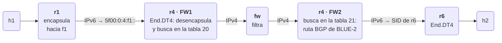

# E6 · Service chaining: el tráfico del cliente pasa por un firewall

> **El caso en una frase**: el operador vende a la empresa BLUE un firewall gestionado, instalado en un punto de su núcleo, y usa SRv6 para que el tráfico entre sedes pase por él **sin cambiar el camino de nadie más** y sin que el firewall sepa nada de SRv6.
>
> **Requisitos previos**: módulos [08](../../08-network-programming/README.md) (*network programming*), [12](../../12-l3vpn-bgp/README.md) (L3VPN IPv4) y [14](../../14-te-srv6/README.md) (ingeniería de tráfico), y el escenario [E1](../E1-multisede/README.md) · Pensado para containerlab 0.82.0, FRR 10.7.1 y netshoot v0.13 · Estado: 🧪 pendiente de probar

## El escenario

```mermaid
graph LR
    h1("🖥️ <b>h1</b><br/>PC1 · sede BLUE-1<br/>eth1: 192.168.10.12/24")
    h11("🖥️ <b>h11</b><br/>PC11 · VLAN 100 (no se usa en E6)<br/>eth1: 192.168.100.11/24, 3fff:168:100::11/64")
    sw1("<b>sw1</b><br/>switch · VLAN 100 (no se usa en E6)")
    r1("<b>r1</b><br/>PE1 · BLUE-1<br/>lo: 3fff:0:ff::1/128<br/>eth1: 3fff:0:12::1/64 (m=10)<br/>eth2: 3fff:0:13::1/64 (m=15)<br/>eth3: 192.168.10.1/24 (VRF BLUE)<br/>locator 5f00:0:1::/48<br/>SID End.DT4 por BGP (VRF BLUE)")
    r2("<b>r2</b><br/>P · FRR (sin BGP)<br/>lo: 3fff:0:ff::2/128<br/>eth1: 3fff:0:12::2/64 (m=10)<br/>eth2: 3fff:0:23::2/64 (m=10)<br/>eth3: 3fff:0:24::2/64 (m=10)<br/>eth4: 3fff:0:25::2/64 (m=25)<br/>locator 5f00:0:2::/48<br/>SID End/End.X automáticos")
    r3("<b>r3</b><br/>P · FRR (sin BGP)<br/>lo: 3fff:0:ff::3/128<br/>eth1: 3fff:0:13::3/64 (m=15)<br/>eth2: 3fff:0:23::3/64 (m=10)<br/>eth3: 3fff:0:35::3/64 (m=10)<br/>eth4: 3fff:0:34::3/64 (m=25)<br/>locator 5f00:0:3::/48<br/>SID End/End.X automáticos")
    r4("<b>r4</b><br/>P + proxy SR del firewall<br/>lo: 3fff:0:ff::4/128<br/>eth1: 3fff:0:24::4/64 (m=10)<br/>eth2: 3fff:0:45::4/64 (m=15)<br/>eth3: 3fff:0:46::4/64 (m=10)<br/>eth4: 3fff:0:34::4/64 (m=25)<br/>eth5: 172.16.41.1/30 (VRF FW1, lado BLUE-1)<br/>eth6: 172.16.42.1/30 (VRF FW2, lado BLUE-2)<br/>locator 5f00:0:4::/48<br/>SID 5f00:0:4:f1:: End.DT4 (VRF FW1)<br/>SID 5f00:0:4:f2:: End.DT4 (VRF FW2)")
    r5("<b>r5</b><br/>P · FRR (sin BGP)<br/>lo: 3fff:0:ff::5/128<br/>eth1: 3fff:0:35::5/64 (m=10)<br/>eth2: 3fff:0:45::5/64 (m=15)<br/>eth3: 3fff:0:56::5/64 (m=10)<br/>eth4: 3fff:0:25::5/64 (m=25)<br/>locator 5f00:0:5::/48<br/>SID End/End.X automáticos")
    fw("🖥️ <b>fw</b><br/>firewall · sin SRv6 (iptables)<br/>eth1: 172.16.41.2/30 (lado BLUE-1)<br/>eth2: 172.16.42.2/30 (lado BLUE-2)")
    r6("<b>r6</b><br/>PE2 · BLUE-2<br/>lo: 3fff:0:ff::6/128<br/>eth1: 3fff:0:46::6/64 (m=10)<br/>eth2: 3fff:0:56::6/64 (m=10)<br/>eth3: 192.168.20.1/24 (VRF BLUE)<br/>locator 5f00:0:6::/48<br/>SID End.DT4 por BGP (VRF BLUE)")
    sw2("<b>sw2</b><br/>switch · VLAN 100 (no se usa en E6)")
    h2("🖥️ <b>h2</b><br/>PC2 · sede BLUE-2 (servicios en los puertos 80 y 23)<br/>eth1: 192.168.20.12/24")
    h12("🖥️ <b>h12</b><br/>PC12 · VLAN 100 (no se usa en E6)<br/>eth1: 192.168.100.12/24, 3fff:168:100::12/64")

    r1 -- "eth1 ⟷ eth1<br/>3fff:0:12::/64 · m=10" --- r2
    r1 -- "eth2 ⟷ eth1<br/>3fff:0:13::/64 · m=15" --- r3
    r2 -- "eth2 ⟷ eth2<br/>3fff:0:23::/64 · m=10" --- r3
    r2 -- "eth3 ⟷ eth1<br/>3fff:0:24::/64 · m=10" --- r4
    r2 -- "eth4 ⟷ eth4<br/>3fff:0:25::/64 · m=25" --- r5
    r3 -- "eth3 ⟷ eth1<br/>3fff:0:35::/64 · m=10" --- r5
    r3 -- "eth4 ⟷ eth4<br/>3fff:0:34::/64 · m=25" --- r4
    r4 -- "eth2 ⟷ eth2<br/>3fff:0:45::/64 · m=15" --- r5
    r4 -- "eth3 ⟷ eth1<br/>3fff:0:46::/64 · m=10" --- r6
    r5 -- "eth3 ⟷ eth2<br/>3fff:0:56::/64 · m=10" --- r6
    h1 -- "eth1 ⟷ eth3<br/>192.168.10.0/24" --- r1
    sw1 -- "eth1 ⟷ eth4" --- r1
    h11 -- "eth1 ⟷ eth2<br/>192.168.100.0/24" --- sw1
    r6 -- "eth3 ⟷ eth1<br/>192.168.20.0/24" --- h2
    r6 -- "eth4 ⟷ eth1" --- sw2
    sw2 -- "eth2 ⟷ eth1<br/>192.168.100.0/24" --- h12
    r4 -- "eth5 ⟷ eth1<br/>172.16.41.0/30" --- fw
    r4 -- "eth6 ⟷ eth2<br/>172.16.42.0/30" --- fw

    classDef router fill:#ddf4ff,stroke:#0969da,stroke-width:2px,color:#1f2328
    classDef host fill:#dafbe1,stroke:#1a7f37,stroke-width:2px,color:#1f2328
    classDef switch fill:#f6f8fa,stroke:#57606a,stroke-width:2px,color:#1f2328
    class r1,r2,r3,r4,r5,r6 router
    class h1,h11,fw,h2,h12 host
    class sw1,sw2 switch
```

<!-- topologia:inicio -->

<!-- topologia:fin -->

> El fichero editable para draw.io está en [`lab/topologia.drawio`](lab/topologia.drawio).

## 1. El caso de uso

BLUE tiene dos sedes unidas por una L3VPN: BLUE-1 (oficinas, `192.168.10.0/24`, en r1) y BLUE-2 (centro de datos, `192.168.20.0/24`, en r6). Su departamento de seguridad exige que **todo el tráfico entre sedes pase por un firewall**, y en particular que nadie pueda abrir sesiones de **telnet** (TCP 23) hacia el centro de datos.

BLUE no quiere un firewall en cada sede: contrata el **firewall gestionado** del operador, que está en su núcleo, colgado de r4. El operador tiene que resolver tres cosas:

- **Llevar el tráfico de BLUE hasta el firewall**, aunque el firewall no esté en el camino entre sus sedes, y después seguir hasta la otra sede.
- **El firewall no entiende SRv6**: es un equipo de un fabricante de seguridad que espera paquetes IPv4 normales, por una interfaz "interior" y otra "exterior".
- **El tráfico de vuelta tiene que pasar por el mismo firewall**: un firewall con estado que solo ve la mitad de una conexión la bloquea.

A esto se le llama **encadenamiento de servicios** (*service function chaining*, SFC): hacer que un tráfico concreto atraviese una secuencia de **funciones de servicio** (firewall, IDS, NAT, balanceador…) en un orden dado.

## 2. Criterios de éxito

Cada criterio es un bloque de `verificar.sh`:

- [ ] **1.** La L3VPN está montada (un `End.DT4` en cada PE) y r4 tiene los dos SIDs del proxy: `5f00:0:4:f1::` y `5f00:0:4:f2::`.
- [ ] **2.** En r4, cada lado del firewall tiene su VRF: lo que entra por un SID va al firewall, y lo que sale del firewall se reencapsula hacia el PE de destino.
- [ ] **3.** Sin la cadena, el tráfico va directo de PE a PE y el firewall no ve nada (y telnet pasa).
- [ ] **4.** (cadena) Con dos estáticas, en r1 y en r6, todo el tráfico entre sedes pasa por el firewall **en los dos sentidos**: el ping y el TCP 80 funcionan, el TCP 23 se bloquea y, entre r4 y el firewall, los paquetes son IPv4 sin SRv6.

## 3. La solución con SRv6

### Una función de servicio es un SID más

En SRv6, una función de servicio es **un segmento de la lista**, igual que un nodo. Si el firewall tiene un SID, llevar el tráfico hasta él es tan fácil como poner ese SID delante del SID de servicio del PE de destino. Hay dos tipos de funciones de servicio:

- **Conscientes de SRv6** (*SR-aware*): procesan la cabecera SRv6. Tienen su propio SID, aplican su función al paquete interior y lo devuelven a la red con el siguiente segmento.
- **No conscientes de SRv6** (*SR-unaware*): la mayoría de los equipos de seguridad. Necesitan un **proxy SR** delante: un router que quita el encapsulado SRv6, entrega el paquete original a la función por una interfaz y, cuando lo recibe de vuelta por otra, **vuelve a encapsularlo** para que siga su camino.

La especificación (*SR service programming*) define tres tipos de proxy:

| Proxy | Behavior | Cómo sabe con qué reencapsular |
|---|---|---|
| **Estático** | `End.AS` | Por configuración: una lista de segmentos fija para lo que vuelve de la función |
| **Dinámico** | `End.AD` | Guarda la cabecera del último paquete que entró y se la vuelve a poner al que sale |
| **Enmascarado** | `End.AM` | No desencapsula: entrega a la función el paquete con la SRH, pero con el destino original, y lo restaura al volver. Solo vale para funciones que no miran la cabecera IPv6 |

> **Lo que no hay en Linux ni en FRR.** Ninguno de los tres proxies está en el kernel de Linux (iproute2 conoce los nombres `End.AS` y `End.AM`, pero el kernel no los implementa), y FRR no los asigna. Existieron en un módulo externo del kernel (SREXT) y están en VPP. Así que en este escenario **montamos un proxy estático con lo que sí hay**: dos `End.DT4` y dos VRF.

### El proxy de r4, pieza a pieza

El firewall (`fw`) tiene dos patas: `eth1` hacia el lado de BLUE-1 y `eth2` hacia el de BLUE-2. En r4, cada pata está en su propia VRF:

| Lado | VRF de r4 | Pata del firewall | SID del proxy | Hacia la otra sede | Hacia su sede |
|---|---|---|---|---|---|
| BLUE-1 | **FW1** (tabla 20), `eth5` | `172.16.41.2` | `5f00:0:4:f1::` (`End.DT4`) | al firewall (estática) | reencapsula hacia r1 (BGP) |
| BLUE-2 | **FW2** (tabla 21), `eth6` | `172.16.42.2` | `5f00:0:4:f2::` (`End.DT4`) | al firewall (estática) | reencapsula hacia r6 (BGP) |

El recorrido de un paquete de h1 a h2:



1. **r1** encapsula el paquete hacia **`5f00:0:4:f1::`** en lugar de hacia el SID de r6. Es una ruta estática con segmentos en la VRF BLUE, como las de E1.
2. **r4** ejecuta el `End.DT4` de f1: desencapsula y busca el destino (`192.168.20.12`) en la tabla de **FW1**, donde una estática lo manda **al firewall**.
3. **El firewall** recibe un paquete IPv4 normal, aplica su política y lo reenvía por su otra pata.
4. **r4** lo recibe por `eth6`, que está en **FW2**. FW2 ha **importado por BGP** las rutas de BLUE (RT `64500:10`), así que tiene la ruta de BLUE-2 con el SID de r6: lo **reencapsula** hacia r6.
5. **r6** lo desencapsula con su `End.DT4`, como en cualquier L3VPN.

La vuelta es simétrica: r6 encapsula hacia **`5f00:0:4:f2::`**, r4 lo entrega al firewall por el lado de BLUE-2 y lo reencapsula hacia r1 desde FW1.

Esto es exactamente un **proxy estático**: lo que vuelve del firewall se reencapsula según lo que diga la configuración de r4, no según la cabecera con la que entró. La diferencia con `End.AS` es que, en vez de una lista de segmentos fija, la "configuración" es la tabla de la VRF, que BGP mantiene al día.

## 4. Decisiones de diseño

| Decisión | Por qué | Alternativa descartada |
|---|---|---|
| Proxy con **`End.DT4` + VRF** | Es lo que hay en Linux y se parece a un `End.AS` | `End.AS`/`End.AD`: no están en el kernel ni en FRR |
| **Una VRF por pata** del firewall | La interfaz por la que vuelve el paquete decide en qué tabla se busca, y así el proxy sabe hacia dónde va | Una sola VRF: el paquete que sale del firewall volvería a entrar en él (bucle) |
| Las VRF del proxy **solo importan** (RT `64500:10`) | r4 aprende por BGP los SIDs de r1 y r6 y no anuncia nada: el resto de la red no cambia | Configurar a mano el SID de r1 y de r6 en r4: se rompe en cuanto BGP asigna otro |
| SIDs del proxy **fijos** (`f1`, `f2`), creados en el kernel | Así las estáticas de r1 y r6 no dependen de lo que asigne BGP. FRR no asigna SIDs a una VRF que no exporta rutas | Un SID automático: habría que leerlo cada vez antes de configurar la cadena |
| La cadena con **estáticas con segmentos** en r1 y r6 | Como en E1: FRR no tiene SR Policy para SRv6 | SR Policy con el SID del proxy en la lista, o un controlador que la programe |
| Cadena **en los dos sentidos** | Un firewall con estado tiene que ver la ida y la vuelta | Solo la ida: el ping funcionaría, pero un firewall con estado rompería las conexiones TCP |
| iBGP **en malla** entre r1, r4 y r6 | Tres routers: más simple que un RR | El RR de E1: lo correcto con más PE |

## 5. Primero, sin la cadena

Con la configuración del laboratorio, BLUE-1 y BLUE-2 se ven por el camino más corto (r1 → r2 → r4 → r6), con un solo SID: el `End.DT4` del PE de destino. El tráfico **pasa por r4**, pero como tránsito: r4 lo reenvía por la ruta del locator de r6 y el firewall no ve nada. Telnet hacia el centro de datos funciona.

Lo esencial del proxy en r4, además del IS-IS y la sesión BGP:

```
router bgp 64500 vrf FW1
 address-family ipv4 unicast
  rd vpn export 64500:41
  rt vpn import 64500:10           ! solo importa: aprende las rutas de BLUE con sus SIDs
  import vpn
!
vrf FW1
 ip route 192.168.20.0/24 172.16.41.2      ! lo que entra por f1 y va a BLUE-2, al firewall
exit-vrf
```

(Y lo mismo para FW2, con `192.168.10.0/24` hacia `172.16.42.2`.) Los dos SIDs se crean en el kernel al arrancar:

```
ip -6 route add 5f00:0:4:f1::/128 encap seg6local action End.DT4 vrftable 20 dev FW1
ip -6 route add 5f00:0:4:f2::/128 encap seg6local action End.DT4 vrftable 21 dev FW2
```

Funcionan porque son direcciones del locator de r4 (`5f00:0:4::/48`), que IS-IS ya anuncia: cualquier router sabe llegar a ellas sin que nadie las anuncie aparte.

## 6. Después, con la cadena

La cadena se activa en los PE, con una estática en cada sentido:

```
! r1: hacia BLUE-2, primero el proxy (lado BLUE-1)
vrf BLUE
 ip route 192.168.20.0/24 3fff:0:12::2 eth1 nexthop-vrf default segments 5f00:0:4:f1::
exit-vrf

! r6: hacia BLUE-1, primero el proxy (lado BLUE-2)
vrf BLUE
 ip route 192.168.10.0/24 3fff:0:46::4 eth1 nexthop-vrf default segments 5f00:0:4:f2::
exit-vrf
```

Fíjate en que la lista tiene **un solo** segmento, el del proxy, y no el SID de r6: quien añade el SID de r6 es r4, al reencapsular. Si quisieras además forzar el camino (por ejemplo, de r1 a r4 por r3), añadirías un segmento delante: `segments 5f00:0:3::/5f00:0:4:f1::`. La TE y el SFC se combinan en la misma lista.

## 7. Lo que verás en el cable

Con la cadena activa, un ping de h1 a h2 se ve así en cada tramo:

| Tramo | Captura en | Qué lleva |
|---|---|---|
| r2 → r4 | r2 `eth3` | IPv6 con destino **`5f00:0:4:f1::`**, SRH de un segmento y dentro el IPv4 de h1 |
| r4 → fw | fw `eth1` | **IPv4 a secas**: `192.168.10.12 → 192.168.20.12`. El firewall no ve nada de SRv6 |
| fw → r4 | fw `eth2` | El mismo IPv4 (si el firewall lo deja pasar) |
| r4 → r6 | r6 `eth1` | IPv6 con destino el **SID de r6** (`5f00:0:6:…`): un paquete **nuevo**, encapsulado por r4 |
| r6 → r4 (vuelta) | r4 `eth3` | IPv6 con destino **`5f00:0:4:f2::`** |

Una conexión a TCP 23 se ve llegar al firewall por `eth1`, pero **no** sale por `eth2`: se queda en la regla de iptables.

## 8. Rómpelo y arréglalo

Con la cadena activa, el firewall deja de reenviar (`sysctl -w net.ipv4.ip_forward=0` en `fw`), como haría un equipo colgado. BLUE-1 y BLUE-2 dejan de verse **del todo**, aunque el núcleo esté perfecto: IS-IS, BGP y los SIDs siguen en su sitio, y desde r1 la ruta parece correcta. Es el riesgo principal de una cadena de servicios: **la función de servicio es un punto de fallo** del que el plano de control no sabe nada. Diagnosticarlo obliga a seguir el paquete tramo a tramo, como en la tabla anterior. La práctica lo plantea paso a paso.

## 9. En producción

- **Proxies de verdad**: los equipos y plataformas que hacen SFC con SRv6 implementan `End.AS`, `End.AD` o `End.AM`, o usan funciones de servicio que entienden SRv6 directamente (algunos firewalls virtuales y appliances basados en VPP lo hacen).
- **Salud de la función de servicio**: el proxy vigila la función (con BFD, sondas, el estado de la interfaz) y, si cae, **retira** su SID o desvía el tráfico a otra instancia. Según la política del cliente, sin firewall el tráfico se descarta (*fail-closed*) o pasa sin filtrar (*fail-open*). En este laboratorio nadie vigila nada: por eso el rómpelo y arréglalo corta el servicio.
- **Varias instancias**: para escalar, varias copias de la misma función, cada una con su SID, y el PE reparte el tráfico entre ellas (como el UCMP de E1) o las elige un controlador.
- **Qué tráfico va a la cadena**: aquí, todo el de una sede. Lo normal es elegirlo por **color** (módulo 14 y E1) o por una política de clasificación en el PE: solo el tráfico de cierta aplicación, o el que va a Internet.
- **La alternativa sin SRv6** es **NSH** (*Network Service Header*), una cabecera específica para SFC. Con SRv6, la propia lista de segmentos es la cadena, y no hace falta otra cabecera ni otro plano de control.

## 10. Resumen

- En SRv6, una **función de servicio es un segmento**: la cadena es la lista de segmentos.
- Las funciones que no entienden SRv6 necesitan un **proxy SR**: estático (`End.AS`), dinámico (`End.AD`) o enmascarado (`End.AM`). Ninguno está en Linux ni en FRR.
- Se puede montar un **proxy estático** con un `End.DT4` y una VRF por cada pata de la función: la VRF por la que vuelve el paquete decide hacia dónde se reencapsula, y BGP mantiene esas rutas al día.
- La cadena se activa en los PE con una **estática con segmentos** hacia el SID del proxy, en **los dos sentidos**, para que un firewall con estado vea la ida y la vuelta.

## Para saber más

- [RFC 7665 · Service Function Chaining (SFC) Architecture](https://www.rfc-editor.org/rfc/rfc7665) — la arquitectura general de SFC
- [draft-ietf-spring-sr-service-programming](https://datatracker.ietf.org/doc/draft-ietf-spring-sr-service-programming/) — funciones de servicio con SR, y los proxies `End.AS`, `End.AD` y `End.AM`
- [RFC 8300 · Network Service Header (NSH)](https://www.rfc-editor.org/rfc/rfc8300) — la alternativa sin SRv6
- [SRv6 en el kernel de Linux](https://segment-routing.net/open-software/linux) — qué behaviors implementa el kernel
