# E6 · Práctica: service chaining con un firewall

Antes de empezar, lee el [planteamiento del escenario](README.md). Los contenedores se llaman `clab-esc-e6-…`.

## Topología

```mermaid
graph LR
    h1("🖥️ <b>h1</b><br/>PC1 · sede BLUE-1<br/>eth1: 192.168.10.12/24")
    h11("🖥️ <b>h11</b><br/>PC11 · VLAN 100 (no se usa en E6)<br/>eth1: 192.168.100.11/24, 3fff:168:100::11/64")
    sw1("<b>sw1</b><br/>switch · VLAN 100 (no se usa en E6)")
    r1("<b>r1</b><br/>PE1 · BLUE-1<br/>lo: 3fff:0:ff::1/128<br/>eth1: 3fff:0:12::1/64 (m=10)<br/>eth2: 3fff:0:13::1/64 (m=15)<br/>eth3: 192.168.10.1/24 (VRF BLUE)<br/>locator 5f00:0:1::/48<br/>SID End.DT4 por BGP (VRF BLUE)")
    r2("<b>r2</b><br/>P · FRR (sin BGP)<br/>lo: 3fff:0:ff::2/128<br/>eth1: 3fff:0:12::2/64 (m=10)<br/>eth2: 3fff:0:23::2/64 (m=10)<br/>eth3: 3fff:0:24::2/64 (m=10)<br/>eth4: 3fff:0:25::2/64 (m=25)<br/>locator 5f00:0:2::/48<br/>SID End/End.X automáticos")
    r3("<b>r3</b><br/>P · FRR (sin BGP)<br/>lo: 3fff:0:ff::3/128<br/>eth1: 3fff:0:13::3/64 (m=15)<br/>eth2: 3fff:0:23::3/64 (m=10)<br/>eth3: 3fff:0:35::3/64 (m=10)<br/>eth4: 3fff:0:34::3/64 (m=25)<br/>locator 5f00:0:3::/48<br/>SID End/End.X automáticos")
    r4("<b>r4</b><br/>P + proxy SR del firewall<br/>lo: 3fff:0:ff::4/128<br/>eth1: 3fff:0:24::4/64 (m=10)<br/>eth2: 3fff:0:45::4/64 (m=15)<br/>eth3: 3fff:0:46::4/64 (m=10)<br/>eth4: 3fff:0:34::4/64 (m=25)<br/>eth5: 172.16.41.1/30 (VRF FW1, lado BLUE-1)<br/>eth6: 172.16.42.1/30 (VRF FW2, lado BLUE-2)<br/>locator 5f00:0:4::/48<br/>SID 5f00:0:4:f1:: End.DT4 (VRF FW1)<br/>SID 5f00:0:4:f2:: End.DT4 (VRF FW2)")
    r5("<b>r5</b><br/>P · FRR (sin BGP)<br/>lo: 3fff:0:ff::5/128<br/>eth1: 3fff:0:35::5/64 (m=10)<br/>eth2: 3fff:0:45::5/64 (m=15)<br/>eth3: 3fff:0:56::5/64 (m=10)<br/>eth4: 3fff:0:25::5/64 (m=25)<br/>locator 5f00:0:5::/48<br/>SID End/End.X automáticos")
    fw("🖥️ <b>fw</b><br/>firewall · sin SRv6 (iptables)<br/>eth1: 172.16.41.2/30 (lado BLUE-1)<br/>eth2: 172.16.42.2/30 (lado BLUE-2)")
    r6("<b>r6</b><br/>PE2 · BLUE-2<br/>lo: 3fff:0:ff::6/128<br/>eth1: 3fff:0:46::6/64 (m=10)<br/>eth2: 3fff:0:56::6/64 (m=10)<br/>eth3: 192.168.20.1/24 (VRF BLUE)<br/>locator 5f00:0:6::/48<br/>SID End.DT4 por BGP (VRF BLUE)")
    sw2("<b>sw2</b><br/>switch · VLAN 100 (no se usa en E6)")
    h2("🖥️ <b>h2</b><br/>PC2 · sede BLUE-2 (servicios en los puertos 80 y 23)<br/>eth1: 192.168.20.12/24")
    h12("🖥️ <b>h12</b><br/>PC12 · VLAN 100 (no se usa en E6)<br/>eth1: 192.168.100.12/24, 3fff:168:100::12/64")

    r1 -- "eth1 ⟷ eth1<br/>3fff:0:12::/64 · m=10" --- r2
    r1 -- "eth2 ⟷ eth1<br/>3fff:0:13::/64 · m=15" --- r3
    r2 -- "eth2 ⟷ eth2<br/>3fff:0:23::/64 · m=10" --- r3
    r2 -- "eth3 ⟷ eth1<br/>3fff:0:24::/64 · m=10" --- r4
    r2 -- "eth4 ⟷ eth4<br/>3fff:0:25::/64 · m=25" --- r5
    r3 -- "eth3 ⟷ eth1<br/>3fff:0:35::/64 · m=10" --- r5
    r3 -- "eth4 ⟷ eth4<br/>3fff:0:34::/64 · m=25" --- r4
    r4 -- "eth2 ⟷ eth2<br/>3fff:0:45::/64 · m=15" --- r5
    r4 -- "eth3 ⟷ eth1<br/>3fff:0:46::/64 · m=10" --- r6
    r5 -- "eth3 ⟷ eth2<br/>3fff:0:56::/64 · m=10" --- r6
    h1 -- "eth1 ⟷ eth3<br/>192.168.10.0/24" --- r1
    sw1 -- "eth1 ⟷ eth4" --- r1
    h11 -- "eth1 ⟷ eth2<br/>192.168.100.0/24" --- sw1
    r6 -- "eth3 ⟷ eth1<br/>192.168.20.0/24" --- h2
    r6 -- "eth4 ⟷ eth1" --- sw2
    sw2 -- "eth2 ⟷ eth1<br/>192.168.100.0/24" --- h12
    r4 -- "eth5 ⟷ eth1<br/>172.16.41.0/30" --- fw
    r4 -- "eth6 ⟷ eth2<br/>172.16.42.0/30" --- fw

    classDef router fill:#ddf4ff,stroke:#0969da,stroke-width:2px,color:#1f2328
    classDef host fill:#dafbe1,stroke:#1a7f37,stroke-width:2px,color:#1f2328
    classDef switch fill:#f6f8fa,stroke:#57606a,stroke-width:2px,color:#1f2328
    class r1,r2,r3,r4,r5,r6 router
    class h1,h11,fw,h2,h12 host
    class sw1,sw2 switch
```

<!-- topologia:inicio -->

<!-- topologia:fin -->

> El fichero editable para draw.io está en [`lab/topologia.drawio`](lab/topologia.drawio).

## Parte A · Ejercicios en papel

**A1.** Un cliente quiere que su tráfico pase por un IDS (que solo mira, en r3) y después por un firewall (en r4) antes de llegar a r6. Si los dos entendieran SRv6 y tuvieran los SIDs `5f00:0:3:a1::` y `5f00:0:4:f1::`, ¿qué lista de segmentos pondría r1? ¿Y en este laboratorio, donde el firewall no entiende SRv6?

**A2.** ¿Por qué el proxy de r4 necesita **dos** VRF? ¿Qué pasaría si las dos patas del firewall estuvieran en la misma?

**A3.** Si solo activas la cadena en r1 (la ida) y no en r6, ¿por dónde vuelven las respuestas de h2? ¿Funcionaría el ping? ¿Y una conexión TCP a través de un firewall con estado?

**A4.** El proxy dinámico (`End.AD`) guarda la cabecera del último paquete que entró para ponérsela al que sale. ¿Qué problema tendría si por el mismo firewall pasaran dos clientes con cadenas distintas?

## Parte B · Levantar y verificar

```
$ cd anexo-escenarios/E6-sfc/lab
$ sudo containerlab deploy -t lab.clab.yml
$ ./verificar.sh
```

`verificar.sh` activa la cadena para probarla y la desactiva al terminar: el laboratorio queda **sin cadena**.

## Parte C · Sin la cadena

**C1.** Mira los SIDs del proxy en r4 y las tablas de sus dos VRF:

```
$ docker exec clab-esc-e6-r4 ip -6 route show | grep seg6local
$ docker exec clab-esc-e6-r4 ip route show vrf FW1
$ docker exec clab-esc-e6-r4 ip route show vrf FW2
```

En cada VRF, ¿qué ruta lleva al firewall y cuál reencapsula? ¿De dónde salen las que reencapsulan? (Pista: `docker exec clab-esc-e6-r4 vtysh -c "show ip route vrf FW1"`.)

**C2.** Pon a cero los contadores del firewall, haz un ping de h1 a h2 y mira los contadores:

```
$ docker exec clab-esc-e6-fw iptables -Z FORWARD
$ docker exec clab-esc-e6-h1 ping -c3 192.168.20.12
$ docker exec clab-esc-e6-fw iptables -L FORWARD -v -n -x
```

¿Pasa el tráfico por r4? ¿Y por el firewall?

**C3.** Comprueba que telnet hacia el centro de datos está abierto: `docker exec clab-esc-e6-h1 timeout 3 bash -c 'echo > /dev/tcp/192.168.20.12/23' && echo abierto`.

## Parte D · Con la cadena

**D1.** Activa la cadena en los dos PE:

```
$ docker exec -it clab-esc-e6-r1 vtysh
r1# configure terminal
r1(config)# vrf BLUE
r1(config-vrf)# ip route 192.168.20.0/24 3fff:0:12::2 eth1 nexthop-vrf default segments 5f00:0:4:f1::

$ docker exec -it clab-esc-e6-r6 vtysh
r6# configure terminal
r6(config)# vrf BLUE
r6(config-vrf)# ip route 192.168.10.0/24 3fff:0:46::4 eth1 nexthop-vrf default segments 5f00:0:4:f2::
```

Mira la ruta de BLUE-2 en el kernel de r1. ¿Hacia qué SID encapsula ahora? ¿Ha cambiado el camino que sigue el paquete entre r1 y r4?

**D2.** Repite C2 y C3. ¿Qué ha cambiado? ¿Y con el puerto 80?

**D3.** Sigue el paquete tramo a tramo. Abre una captura en cada uno de estos puntos mientras haces ping de h1 a h2, y anota el destino y si es IPv4 o IPv6:

```
$ docker run --rm -it --net container:clab-esc-e6-r2 nicolaka/netshoot:v0.13 tcpdump -ni eth3 -c3 ip6
$ docker run --rm -it --net container:clab-esc-e6-fw nicolaka/netshoot:v0.13 tcpdump -ni eth1 -c3 icmp
$ docker run --rm -it --net container:clab-esc-e6-fw nicolaka/netshoot:v0.13 tcpdump -ni eth2 -c3 icmp
$ docker run --rm -it --net container:clab-esc-e6-r6 nicolaka/netshoot:v0.13 tcpdump -ni eth1 -c3 ip6
```

¿En qué tramo cambia el destino IPv6? ¿Quién construye el paquete que llega a r6?

**D4.** Prueba ahora el telnet mientras capturas en las dos patas del firewall. ¿Por cuál aparece el SYN? ¿Por cuál no?

**D5.** Quita la estática de r6 (la vuelta), deja la de r1 y repite el ping. ¿Funciona? Captura en `fw eth2`: ¿pasan por el firewall las respuestas? Vuelve a ponerla.

## Parte E · Rómpelo y arréglalo

**E1.** Con la cadena activa, "cuelga" el firewall:

```
$ docker exec clab-esc-e6-fw sysctl -w net.ipv4.ip_forward=0
```

Haz ping de h1 a h2. ¿Funciona? Mira en r1 la sesión BGP, la ruta de BLUE-2 y el SID del proxy en r4. ¿Algo de eso avisa del problema?

**E2.** Localiza el fallo con las capturas de D3. ¿Hasta qué tramo llega el paquete?

**E3.** Arréglalo (`net.ipv4.ip_forward=1`). Después, piensa: si el firewall no se pudiera arreglar enseguida, ¿qué cambiarías en r1 y r6 para que BLUE siguiera funcionando? ¿Qué le parecería al departamento de seguridad del cliente?

**E4.** Quita las dos estáticas y comprueba con `./verificar.sh` que todo vuelve a estar en verde.

## Al terminar

```
$ sudo containerlab destroy -t lab.clab.yml --cleanup
```

Compara tus respuestas con las [soluciones](soluciones.md).
