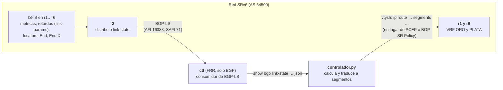

# E7 · Ingeniería de tráfico con un controlador: BGP-LS y un script en Python

> **El caso en una frase**: el operador deja de decidir los caminos a mano. Un controlador lee la topología SRv6 de la red por **BGP-LS**, calcula el camino de cada servicio según lo que pide, lo convierte en una lista de segmentos y la programa en los PE. Y cuando se cae un enlace, recalcula.
>
> **Requisitos previos**: módulos [11](../../11-isis-srv6/README.md) (IS-IS con SRv6), [12](../../12-l3vpn-bgp/README.md) (L3VPN IPv4) y [14](../../14-te-srv6/README.md) (ingeniería de tráfico), y el escenario [E4](../E4-slicing/README.md) (las rebanadas ORO y PLATA) · Necesita `python3` en la máquina donde corre containerlab (solo la biblioteca estándar) · Probado con containerlab 0.82.0 sobre OrbStack, FRR 10.7.1 y netshoot v0.13 (29/29 comprobaciones) · Estado: ✅

> ⚠️ **Lo que FRR hace y lo que no.** FRR 10.7 **sí** exporta la topología SRv6 por BGP-LS: nodos, enlaces con su métrica y su retardo, locators y SIDs `End` y `End.X`. Pero **no** acepta que un controlador le programe una política SRv6 (ni por PCEP ni por BGP SR Policy). Por eso el script de este escenario **lee** la red como lo haría un controlador real y **programa** los PE con `vtysh`, como lo haría un operador. La [sección 9](#9-lo-que-frr-aún-no-hace) lo detalla.

## El escenario

```mermaid
graph LR
    h1("🖥️ <b>h1</b><br/>PC1 · sede ORO-1<br/>eth1: 192.168.10.12/24")
    h11("🖥️ <b>h11</b><br/>PC11 · sede PLATA-1<br/>eth1: 192.168.110.11/24")
    sw1("<b>sw1</b><br/>switch · sede PLATA-1")
    r1("<b>r1</b><br/>PE1 · ORO-1 y PLATA-1<br/>lo: 3fff:0:ff::1/128<br/>eth1: 3fff:0:12::1/64 (m=10, 2 ms)<br/>eth2: 3fff:0:13::1/64 (m=15, 2 ms)<br/>eth3: 192.168.10.1/24 (VRF ORO)<br/>eth4: 192.168.110.1/24 (VRF PLATA)<br/>locator 5f00:0:1::/48<br/>SID End.DT4 por BGP (VRF ORO) · End.DT4 por BGP (VRF PLATA)")
    ctl("🖥️ <b>ctl</b><br/>controlador · FRR solo con BGP (consumidor de BGP-LS)<br/>eth1: 3fff:0:c2::100/64")
    r2("<b>r2</b><br/>P · productor de BGP-LS<br/>lo: 3fff:0:ff::2/128<br/>eth1: 3fff:0:12::2/64 (m=10, 2 ms)<br/>eth2: 3fff:0:23::2/64 (m=10, 1 ms)<br/>eth3: 3fff:0:24::2/64 (m=10, 5 ms)<br/>eth4: 3fff:0:25::2/64 (m=25, 3 ms)<br/>eth5: 3fff:0:c2::2/64 (al controlador)<br/>locator 5f00:0:2::/48<br/>SID End/End.X automáticos")
    r3("<b>r3</b><br/>P<br/>lo: 3fff:0:ff::3/128<br/>eth1: 3fff:0:13::3/64 (m=15, 2 ms)<br/>eth2: 3fff:0:23::3/64 (m=10, 1 ms)<br/>eth3: 3fff:0:35::3/64 (m=10, 2 ms)<br/>eth4: 3fff:0:34::3/64 (m=25, 4 ms)<br/>locator 5f00:0:3::/48<br/>SID End/End.X automáticos")
    r4("<b>r4</b><br/>P<br/>lo: 3fff:0:ff::4/128<br/>eth1: 3fff:0:24::4/64 (m=10, 5 ms)<br/>eth2: 3fff:0:45::4/64 (m=15, 1 ms)<br/>eth3: 3fff:0:46::4/64 (m=10, 2 ms)<br/>eth4: 3fff:0:34::4/64 (m=25, 4 ms)<br/>locator 5f00:0:4::/48<br/>SID End/End.X automáticos")
    r5("<b>r5</b><br/>P<br/>lo: 3fff:0:ff::5/128<br/>eth1: 3fff:0:35::5/64 (m=10, 2 ms)<br/>eth2: 3fff:0:45::5/64 (m=15, 1 ms)<br/>eth3: 3fff:0:56::5/64 (m=10, 2 ms)<br/>eth4: 3fff:0:25::5/64 (m=25, 3 ms)<br/>locator 5f00:0:5::/48<br/>SID End/End.X automáticos")
    r6("<b>r6</b><br/>PE2 · ORO-2 y PLATA-2<br/>lo: 3fff:0:ff::6/128<br/>eth1: 3fff:0:46::6/64 (m=10, 2 ms)<br/>eth2: 3fff:0:56::6/64 (m=10, 2 ms)<br/>eth3: 192.168.20.1/24 (VRF ORO)<br/>eth4: 192.168.120.1/24 (VRF PLATA)<br/>locator 5f00:0:6::/48<br/>SID End.DT4 por BGP (VRF ORO) · End.DT4 por BGP (VRF PLATA)")
    sw2("<b>sw2</b><br/>switch · sede PLATA-2")
    h2("🖥️ <b>h2</b><br/>PC2 · sede ORO-2<br/>eth1: 192.168.20.12/24")
    h12("🖥️ <b>h12</b><br/>PC12 · sede PLATA-2<br/>eth1: 192.168.120.12/24")

    r1 -- "eth1 ⟷ eth1<br/>3fff:0:12::/64" --- r2
    r1 -- "eth2 ⟷ eth1<br/>3fff:0:13::/64" --- r3
    r2 -- "eth2 ⟷ eth2<br/>3fff:0:23::/64" --- r3
    r2 -- "eth3 ⟷ eth1<br/>3fff:0:24::/64" --- r4
    r2 -- "eth4 ⟷ eth4<br/>3fff:0:25::/64" --- r5
    r3 -- "eth3 ⟷ eth1<br/>3fff:0:35::/64" --- r5
    r3 -- "eth4 ⟷ eth4<br/>3fff:0:34::/64" --- r4
    r4 -- "eth2 ⟷ eth2<br/>3fff:0:45::/64" --- r5
    r4 -- "eth3 ⟷ eth1<br/>3fff:0:46::/64" --- r6
    r5 -- "eth3 ⟷ eth2<br/>3fff:0:56::/64" --- r6
    h1 -- "eth1 ⟷ eth3<br/>192.168.10.0/24" --- r1
    sw1 -- "eth1 ⟷ eth4<br/>192.168.110.0/24" --- r1
    h11 -- "eth1 ⟷ eth2<br/>192.168.110.0/24" --- sw1
    r6 -- "eth3 ⟷ eth1<br/>192.168.20.0/24" --- h2
    r6 -- "eth4 ⟷ eth1<br/>192.168.120.0/24" --- sw2
    sw2 -- "eth2 ⟷ eth1<br/>192.168.120.0/24" --- h12
    r2 -- "eth5 ⟷ eth1<br/>3fff:0:c2::/64" --- ctl

    classDef router fill:#ddf4ff,stroke:#0969da,stroke-width:2px,color:#1f2328
    classDef host fill:#dafbe1,stroke:#1a7f37,stroke-width:2px,color:#1f2328
    classDef switch fill:#f6f8fa,stroke:#57606a,stroke-width:2px,color:#1f2328
    class r1,r2,r3,r4,r5,r6 router
    class h1,h11,ctl,h2,h12 host
    class sw1,sw2 switch
```

<!-- topologia:inicio -->

<!-- topologia:fin -->

> El fichero editable para draw.io está en [`lab/topologia.drawio`](lab/topologia.drawio). Cada enlace muestra su métrica IGP y su retardo.

## 1. El caso de uso

En E4, el operador fijó a mano el camino de sus dos rebanadas, ORO (baja latencia) y PLATA (tráfico masivo), con un script que ya sabía la respuesta. Eso tiene tres problemas:

- **Alguien tiene que calcular los caminos**, y con muchos servicios y una red grande no se puede hacer a mano.
- **El camino de menor retardo no es el más corto del IGP.** IS-IS suma métricas, no retardos. En esta red, el camino más corto de r1 a r6 (r1 → r2 → r4 → r6, coste 30) pasa por un enlace de 5 ms (r2–r4), y el de menor retardo es otro (r1 → r3 → r5 → r6, 6 ms).
- **Cuando la red cambia, nadie reacciona.** Si cae un enlace del camino de ORO, las estáticas de E4 siguen apuntando a donde ya no se puede llegar.

El operador quiere un **controlador** que:

1. conozca la topología, con métricas, retardos y SIDs, sin configurarla a mano;
2. calcule para **ORO** el camino de **mínimo retardo**, y para **PLATA** el de **mínima métrica IGP sin usar ningún enlace de ORO**;
3. lo traduzca a la **lista de segmentos más corta posible**;
4. y vuelva a calcular cuando cambie la red.

## 2. Criterios de éxito

Cada criterio es un bloque de `verificar.sh`:

- [ ] **1.** El controlador (`ctl`) tiene por BGP-LS toda la topología: 6 nodos, 10 enlaces (20 NLRI, una por sentido), los SIDs de nodo y, en cada enlace, su métrica IGP, su retardo y su `End.X`.
- [ ] **2.** `controlador.py` programa ORO por r3 y r5 (menor retardo) y PLATA por r2 y r4, en los dos sentidos, y el tráfico va por ahí.
- [ ] **3.** Cae el enlace r3–r5: BGP-LS lo retira y el controlador reprograma. ORO pasa a ir por r2 y r5 **con un `End.X`**, y PLATA por r3.
- [ ] **4.** Vuelve el enlace y el controlador deshace el cambio. `--limpiar` devuelve las rebanadas a las rutas de BGP.

## 3. La solución



### Leer la red: BGP-LS

**BGP-LS** (RFC 9552) es una familia de direcciones de BGP que no transporta rutas, sino **la base de datos del IGP**: cada router, cada enlace y cada prefijo, con sus atributos. Con las extensiones de SRv6 (RFC 9514), también los locators y los SIDs. Basta con **un** router que participe en IS-IS para exportar la topología de todo el dominio, porque todos tienen la misma base de datos.

- **r2** es el **productor**: `distribute link-state` en IS-IS entrega la base de datos a BGP, y una sesión con la familia `link-state` la envía a ctl.
- **ctl** es el **consumidor**: un FRR que solo ejecuta BGP. No participa en IS-IS ni enruta nada. Solo guarda lo que recibe y lo enseña con `show bgp link-state link-state json`.
- **Cada enlace del núcleo anuncia su retardo** con `link-params` (en microsegundos). IS-IS lo lleva en sus extensiones de TE (RFC 8570) y BGP-LS lo pasa al controlador.

Lo que el controlador saca de cada tipo de NLRI:

| NLRI | De qué habla | Lo que usa el controlador |
|---|---|---|
| `node` | Un router | Su nombre (`nodeName`) a partir de su ID de IS-IS |
| `srv6Sid` | Un SID de nodo | El `End` de cada router (`5f00:0:N::`) |
| `link` | Un enlace, **en un sentido** | `igpMetric`, `delay`, la dirección del vecino y el `End.X` del enlace |
| `ipv6Prefix` | Un prefijo, incluido el locator | (no lo usa: el `End` ya identifica al nodo) |

> **Lo que BGP-LS no trae: los SIDs de servicio.** Los `End.DT4` de las VRF los asigna BGP, no IS-IS, y BGP-LS solo exporta lo que hay en el IGP (y las SIDs estáticas). El script los lee del kernel del PE de destino. Un controlador real los aprendería escuchando las rutas VPN por BGP.

### Calcular: Dijkstra con otro peso

El controlador ejecuta su propio Dijkstra sobre el grafo que ha leído, **con el peso que pida cada servicio**: el retardo para ORO y la métrica IGP para PLATA. Para PLATA quita antes del grafo los enlaces del camino de ORO. El resultado:

| Servicio | Camino | Coste | IS-IS habría elegido |
|---|---|---|---|
| ORO | r1 → r3 → r5 → r6 | 6 ms | r1 → r2 → r4 → r6 (9 ms) |
| PLATA | r1 → r2 → r4 → r6 | IGP 30 | lo mismo |

### Traducir: la lista de segmentos más corta

Un camino no es todavía una lista de segmentos. El script la construye con una regla sencilla:

1. Se empieza **en el propio PE** y se avanza todo lo posible **mientras el camino deseado coincida con el camino más corto del IGP, y sea el único** (sin ECMP). Donde deja de coincidir, se pone el **`End`** de ese nodo: "ve por el camino más corto hasta aquí".
2. Si **ni siquiera el siguiente salto** es el camino más corto único, se pone el **`End.X`** de ese enlace: "sal por este enlace". Si justo antes había un `End` de ese mismo nodo, sobra: el `End.X` ya lleva hasta él.
3. El último segmento es siempre el **SID de servicio** del PE de destino.

Con la red entera, ORO necesita **dos** segmentos: de r1 a r5, el camino más corto ya es r1 → r3 → r5, así que basta el `End` de r5; y de r5 a r6, el enlace directo. PLATA va por el camino del IGP y le basta **uno**, el SID de servicio. La ingeniería de tráfico más barata es la que no añade ningún SID.

> **Lo que aprendimos probando este escenario: el siguiente salto de la estática no fija el camino.** La primera versión del script suponía que el primer salto lo decidía la estática (`ip route … 3fff:0:13::3 eth2 … segments …`) y ahorraba un segmento. En la prueba, el tráfico de ORO no pasaba por r3. El motivo: cuando el kernel de Linux encapsula un paquete reenviado, **vuelve a enrutar el paquete IPv6 por su destino exterior** (el primer segmento) e ignora el siguiente salto de la ruta. El paquete, con destino el SID de r6, iba por el camino más corto: r2 y r4. Por eso la lista se calcula desde el propio PE. En E1, E4, E5 y E6 no se notaba porque el primer segmento ya llevaba el paquete por el camino deseado.

### Reaccionar: cae r3–r5

Al caer el enlace, IS-IS lo retira de su base de datos, BGP-LS retira las dos NLRI del enlace y, la próxima vez que se ejecuta, el controlador ve otra red:

| Servicio | Camino nuevo | Segmentos | Por qué |
|---|---|---|---|
| ORO ida | r1 → r2 → r5 → r6 (7 ms) | **`End.X` de r2 hacia r5**, SID de r6 | Desde r2, ir a r5 directo (coste 25) empata con r2 → r4 → r5 (25). Un `End` de r5 dejaría la elección al ECMP de r2, así que hace falta el `End.X`, que además ya lleva el paquete hasta r2 |
| ORO vuelta | r6 → r5 → r2 → r1 | `End.X` de r5 hacia r2, SID de r1 | El mismo empate, al revés |
| PLATA ida | r1 → r3 → r2 → r4 → r6 | **`End` de r3**, SID de r6 | Desde r1, el más corto a r6 iría por r2; forzado el paso por r3, desde r3 el más corto ya es r3 → r2 → r4 → r6 |
| PLATA vuelta | r6 → r4 → r2 → r3 → r1 | **`End` de r3**, SID de r1 | Desde r4, el más corto a r1 sería r4 → r2 → r1: hay que forzar el paso por r3 |

Fíjate en que PLATA también cambia, aunque el enlace caído no era suyo: como ORO ahora usa r1–r2 y r2–r5, PLATA tiene que salir de ahí.

## 4. Decisiones de diseño

| Decisión | Por qué | Alternativa descartada |
|---|---|---|
| **r2** como productor de BGP-LS | Basta un router del dominio IS-IS. r2 está en el centro y el controlador cuelga de él | Todos los routers exportando: redundante; en producción se usan dos productores por si uno cae |
| ctl con **FRR** como consumidor | FRR descodifica BGP-LS y lo enseña en JSON: el script solo lee JSON | Un decodificador propio, o GoBGP o ExaBGP: más dependencias y más código que no es lo que se quiere enseñar |
| Script **en el anfitrión**, con `docker exec` | Puede leer de ctl y programar r1 y r6 sin instalar nada en los contenedores | Script dentro de ctl: no tendría forma de programar los PE (FRR no acepta políticas SRv6 de fuera) |
| **Retardo anunciado**, no medido | `link-params delay` es un valor configurado; así el resultado es reproducible | Retardo medido (TWAMP, módulo 17): lo correcto en producción, pero FRR no lo mide para IS-IS |
| Minimizar la lista de segmentos | Cada SID son 16 bytes más por paquete; y una lista corta deja trabajar al IGP | Poner el `End` de cada nodo del camino: funciona, pero es más larga y frágil |
| Modo **"ejecuta y termina"** (y `--bucle`) | Para la verificación conviene que cada paso sea explícito. `--bucle` muestra la reacción automática | Un servicio que escuche eventos de BGP-LS: lo correcto, pero mucho más código |

## 5. Primero, la topología

Antes de calcular nada, mira lo que sabe el controlador:

```
$ docker exec clab-esc-e7-ctl vtysh -c "show bgp link-state link-state"
$ ./controlador.py --ver
```

`--ver` calcula y enseña los caminos y los segmentos, sin programar nada. Sin el controlador, las rebanadas van por las rutas de BGP: las dos por el camino más corto, como en E4 sin rebanadas.

## 6. Después, el controlador

```
$ ./controlador.py
ORO ida       r1-r3-r5-r6     retardo=6000   segmentos: 5f00:0:6:…
              → programado en r1 (VRF ORO)
…
```

Y para verlo reaccionar solo, en una terminal:

```
$ ./controlador.py --bucle
```

y en otra, tumba el enlace r3–r5:

```
$ docker exec clab-esc-e7-r3 ip link set eth3 down
$ docker exec clab-esc-e7-r5 ip link set eth1 down
```

En unos segundos, el bucle detecta la red nueva y reprograma los cuatro servicios.

## 7. Lo que verás en el cable

| Situación | Captura | Qué lleva |
|---|---|---|
| Red entera, ORO, de r3 a r5 | r3 `eth3` | IPv6 hacia **`5f00:0:5::`** (el `End` de r5), SRH de dos segmentos |
| Red entera, ORO, de r5 a r6 | r6 `eth2` | IPv6 hacia el SID de ORO de r6: r5 ya ha procesado su `End` |
| Red entera, PLATA | r2 `eth3` (hacia r4) | IPv6 hacia el SID de PLATA de r6 |
| r3–r5 caído, ORO, de r1 a r2 | r2 `eth1` | IPv6 hacia el **`End.X` de r2** (`5f00:0:2:…`), SRH de dos segmentos |
| r3–r5 caído, ORO, de r2 a r5 | r5 `eth4` | IPv6 hacia el SID de ORO de r6: r2 ya ha ejecutado su `End.X` |

## 8. Rómpelo y arréglalo

Corta la sesión BGP-LS (en ctl, `neighbor 3fff:0:c2::2 shutdown`) y luego tumba r3–r5. Al caer la sesión, ctl borra lo que había aprendido de r2, y el controlador se niega a calcular: no tiene topología. Pero las estáticas que programó antes **siguen en los PE**. ORO sigue funcionando, porque su lista solo nombra a r5 y el IGP encuentra otro camino hasta él. Pero r1 tiene dos caminos de igual coste hacia r5 (r1 → r2 → r5 y r1 → r2 → r4 → r5), y por el segundo ORO tarda **10 ms**, más que los 7 ms del mejor camino posible. Nadie lo corrige: la promesa a ORO se rompe en silencio. Es el riesgo de cualquier controlador que pierde la vista de la red. La práctica lo plantea paso a paso.

## 9. Lo que FRR aún no hace

| Pieza | En un controlador comercial | ¿En FRR 10.7.1? | En este laboratorio |
|---|---|---|---|
| **Exportar la topología SRv6** por BGP-LS (RFC 9552, RFC 9514) | Sí | ✅ Nodos, enlaces, prefijos, locators, `End` y `End.X`, con métrica IGP y retardo | Lo usamos tal cual |
| **SIDs de servicio** (los de BGP) en BGP-LS | Se aprenden por BGP VPN | ⚠️ BGP-LS exporta los SIDs del IGP y los estáticos de zebra, no los que asigna BGP | El script los lee del PE |
| **Programar una SR Policy** desde el controlador (PCEP con SRv6, RFC 9603; o BGP SR Policy, RFC 9830) | Sí | ❌ `pathd` solo hace SR-MPLS; FRR no acepta políticas SRv6 de fuera | `vtysh` con `docker exec` |
| **Steering** del tráfico a la política (color, *automated steering*) | Sí | ❌ Sin SR Policy SRv6 no hay color | Una estática por VRF y prefijo |
| **Retardo medido** (TWAMP, anunciado en IS-IS) | Sí | ⚠️ El retardo se configura (`link-params delay`); nadie lo mide | Valores fijos |
| **Notificación de cambios** al controlador | Por las propias actualizaciones de BGP-LS | ✅ BGP-LS envía las altas y bajas | El script **sondea** cada 5 s en lugar de escucharlas |
| **Protección** mientras el controlador recalcula (TI-LFA) | Sí | ❌ No hay TI-LFA en SRv6 (módulo 15) | Unos segundos sin servicio en ORO hasta que el script reprograma |

## 10. En producción

- **Controladores de verdad** (de los fabricantes, o abiertos como los basados en ONOS u OpenDaylight) hacen lo mismo que este script, pero escuchan BGP-LS en tiempo real, mantienen una **base de datos de TE** con el ancho de banda reservado, y programan **SR Policies** por PCEP o BGP. El PE asocia cada VPN a su política por **color**.
- **Optimizar listas de segmentos** es un problema conocido: los controladores usan algoritmos como el de este script, más restricciones de **profundidad máxima** (MSD: cuántos SIDs puede poner cada PE). BGP-LS también anuncia la MSD de cada nodo.
- **Si el controlador cae**, la red sigue funcionando con las últimas políticas. Por eso las políticas de producción tienen un **camino de respaldo** (un candidato con menor preferencia, o el camino del IGP) y la protección local (TI-LFA) no depende del controlador.
- **Varias fuentes**: BGP-LS para la topología, telemetría (gNMI) para la carga de cada enlace y retardo medido con TWAMP. Con eso, el controlador puede mover tráfico cuando un enlace se satura, no solo cuando se cae.

## 11. Resumen

- **BGP-LS** lleva la base de datos de IS-IS a un controlador: un router productor (`distribute link-state`) y una sesión BGP con la familia `link-state`. FRR 10.7 incluye los locators y los SIDs `End`/`End.X`, y el retardo de cada enlace.
- Un **controlador** calcula caminos con **otros pesos** (retardo) y **restricciones** (enlaces prohibidos) que el IGP no conoce, y los traduce a la **lista de segmentos más corta**: `End` donde el camino se separa del más corto del IGP, `End.X` donde hay un empate.
- Cuando cae un enlace, BGP-LS lo retira y el controlador **recalcula y reprograma**.
- FRR **no acepta** que un controlador le programe una política SRv6. Aquí el script programa los PE con `vtysh`, pero en producción se haría con PCEP o BGP SR Policy.

## Para saber más

- [RFC 9552 · Distribution of Link-State and TE Information Using BGP (BGP-LS)](https://www.rfc-editor.org/rfc/rfc9552)
- [RFC 9514 · BGP-LS Extensions for SRv6](https://www.rfc-editor.org/rfc/rfc9514)
- [RFC 8570 · IS-IS Traffic Engineering Metric Extensions](https://www.rfc-editor.org/rfc/rfc8570) — el retardo de cada enlace
- [RFC 9256 · Segment Routing Policy Architecture](https://www.rfc-editor.org/rfc/rfc9256)
- [FRR 10.7.0 · notas de la versión](https://github.com/FRRouting/frr/releases/tag/frr-10.7.0) — BGP-LS y sus extensiones SRv6
