# E7 · Práctica: un controlador con BGP-LS

Antes de empezar, lee el [planteamiento del escenario](README.md). Los contenedores se llaman `clab-esc-e7-…`. Todos los comandos con `./` se ejecutan desde la carpeta `lab/`.

## Topología

```mermaid
graph LR
    h1("🖥️ <b>h1</b><br/>PC1 · sede ORO-1<br/>eth1: 192.168.10.12/24")
    h11("🖥️ <b>h11</b><br/>PC11 · sede PLATA-1<br/>eth1: 192.168.110.11/24")
    sw1("<b>sw1</b><br/>switch · sede PLATA-1")
    r1("<b>r1</b><br/>PE1 · ORO-1 y PLATA-1<br/>lo: 3fff:0:ff::1/128<br/>eth1: 3fff:0:12::1/64 (m=10, 2 ms)<br/>eth2: 3fff:0:13::1/64 (m=15, 2 ms)<br/>eth3: 192.168.10.1/24 (VRF ORO)<br/>eth4: 192.168.110.1/24 (VRF PLATA)<br/>locator 5f00:0:1::/48<br/>SID End.DT4 por BGP (VRF ORO) · End.DT4 por BGP (VRF PLATA)")
    ctl("🖥️ <b>ctl</b><br/>controlador · FRR solo con BGP (consumidor de BGP-LS)<br/>eth1: 3fff:0:c2::100/64")
    r2("<b>r2</b><br/>P · productor de BGP-LS<br/>lo: 3fff:0:ff::2/128<br/>eth1: 3fff:0:12::2/64 (m=10, 2 ms)<br/>eth2: 3fff:0:23::2/64 (m=10, 1 ms)<br/>eth3: 3fff:0:24::2/64 (m=10, 5 ms)<br/>eth4: 3fff:0:25::2/64 (m=25, 3 ms)<br/>eth5: 3fff:0:c2::2/64 (al controlador)<br/>locator 5f00:0:2::/48<br/>SID End/End.X automáticos")
    r3("<b>r3</b><br/>P<br/>lo: 3fff:0:ff::3/128<br/>eth1: 3fff:0:13::3/64 (m=15, 2 ms)<br/>eth2: 3fff:0:23::3/64 (m=10, 1 ms)<br/>eth3: 3fff:0:35::3/64 (m=10, 2 ms)<br/>eth4: 3fff:0:34::3/64 (m=25, 4 ms)<br/>locator 5f00:0:3::/48<br/>SID End/End.X automáticos")
    r4("<b>r4</b><br/>P<br/>lo: 3fff:0:ff::4/128<br/>eth1: 3fff:0:24::4/64 (m=10, 5 ms)<br/>eth2: 3fff:0:45::4/64 (m=15, 1 ms)<br/>eth3: 3fff:0:46::4/64 (m=10, 2 ms)<br/>eth4: 3fff:0:34::4/64 (m=25, 4 ms)<br/>locator 5f00:0:4::/48<br/>SID End/End.X automáticos")
    r5("<b>r5</b><br/>P<br/>lo: 3fff:0:ff::5/128<br/>eth1: 3fff:0:35::5/64 (m=10, 2 ms)<br/>eth2: 3fff:0:45::5/64 (m=15, 1 ms)<br/>eth3: 3fff:0:56::5/64 (m=10, 2 ms)<br/>eth4: 3fff:0:25::5/64 (m=25, 3 ms)<br/>locator 5f00:0:5::/48<br/>SID End/End.X automáticos")
    r6("<b>r6</b><br/>PE2 · ORO-2 y PLATA-2<br/>lo: 3fff:0:ff::6/128<br/>eth1: 3fff:0:46::6/64 (m=10, 2 ms)<br/>eth2: 3fff:0:56::6/64 (m=10, 2 ms)<br/>eth3: 192.168.20.1/24 (VRF ORO)<br/>eth4: 192.168.120.1/24 (VRF PLATA)<br/>locator 5f00:0:6::/48<br/>SID End.DT4 por BGP (VRF ORO) · End.DT4 por BGP (VRF PLATA)")
    sw2("<b>sw2</b><br/>switch · sede PLATA-2")
    h2("🖥️ <b>h2</b><br/>PC2 · sede ORO-2<br/>eth1: 192.168.20.12/24")
    h12("🖥️ <b>h12</b><br/>PC12 · sede PLATA-2<br/>eth1: 192.168.120.12/24")

    r1 -- "eth1 ⟷ eth1<br/>3fff:0:12::/64" --- r2
    r1 -- "eth2 ⟷ eth1<br/>3fff:0:13::/64" --- r3
    r2 -- "eth2 ⟷ eth2<br/>3fff:0:23::/64" --- r3
    r2 -- "eth3 ⟷ eth1<br/>3fff:0:24::/64" --- r4
    r2 -- "eth4 ⟷ eth4<br/>3fff:0:25::/64" --- r5
    r3 -- "eth3 ⟷ eth1<br/>3fff:0:35::/64" --- r5
    r3 -- "eth4 ⟷ eth4<br/>3fff:0:34::/64" --- r4
    r4 -- "eth2 ⟷ eth2<br/>3fff:0:45::/64" --- r5
    r4 -- "eth3 ⟷ eth1<br/>3fff:0:46::/64" --- r6
    r5 -- "eth3 ⟷ eth2<br/>3fff:0:56::/64" --- r6
    h1 -- "eth1 ⟷ eth3<br/>192.168.10.0/24" --- r1
    sw1 -- "eth1 ⟷ eth4<br/>192.168.110.0/24" --- r1
    h11 -- "eth1 ⟷ eth2<br/>192.168.110.0/24" --- sw1
    r6 -- "eth3 ⟷ eth1<br/>192.168.20.0/24" --- h2
    r6 -- "eth4 ⟷ eth1<br/>192.168.120.0/24" --- sw2
    sw2 -- "eth2 ⟷ eth1<br/>192.168.120.0/24" --- h12
    r2 -- "eth5 ⟷ eth1<br/>3fff:0:c2::/64" --- ctl

    classDef router fill:#ddf4ff,stroke:#0969da,stroke-width:2px,color:#1f2328
    classDef host fill:#dafbe1,stroke:#1a7f37,stroke-width:2px,color:#1f2328
    classDef switch fill:#f6f8fa,stroke:#57606a,stroke-width:2px,color:#1f2328
    class r1,r2,r3,r4,r5,r6 router
    class h1,h11,ctl,h2,h12 host
    class sw1,sw2 switch
```

<!-- topologia:inicio -->

<!-- topologia:fin -->

> El fichero editable para draw.io está en [`lab/topologia.drawio`](lab/topologia.drawio).

## Parte A · Ejercicios en papel

Usa las métricas y los retardos del esquema.

**A1.** ¿Por qué basta con que **un** router (r2) exporte la topología por BGP-LS? ¿Qué pasaría si r2 se cayera? ¿Cómo lo resolverías?

**A2.** Supón que el enlace r3–r5 tuviera 6 ms de retardo en vez de 2. ¿Cuál sería el camino de menor retardo de r1 a r6? Aplica la regla de la sección 3 del README: ¿qué segmentos necesita?

**A3.** En la regla de traducción, ¿por qué no basta con que el camino deseado sea **un** camino de coste mínimo del IGP? ¿Por qué tiene que ser **el único**?

**A4.** El controlador pierde la sesión BGP-LS. ¿Qué debería hacer con las estáticas que ya programó: dejarlas o quitarlas? Piensa en ventajas e inconvenientes de cada opción.

## Parte B · Levantar y verificar

```
$ cd anexo-escenarios/E7-controlador/lab
$ sudo containerlab deploy -t lab.clab.yml
$ ./verificar.sh
```

`verificar.sh` ejecuta el controlador, tumba y levanta el enlace r3–r5 y, al terminar, deja las rebanadas en las rutas de BGP (`--limpiar`).

## Parte C · Lo que sabe el controlador

**C1.** Mira el resumen de BGP-LS en ctl y cuenta las NLRI de cada tipo:

```
$ docker exec clab-esc-e7-ctl vtysh -c "show bgp link-state link-state"
$ docker exec clab-esc-e7-ctl vtysh -c "show bgp link-state link-state json" | \
    python3 -c "import json,sys,collections; r=json.load(sys.stdin)['routes']; print(collections.Counter(v[0]['nlri']['nlriType'] for v in r.values()))"
```

¿Cuántas hay de cada tipo? ¿Qué describe cada una? ¿Por qué hay el doble de NLRI de enlace que enlaces?

**C2.** Busca en el JSON la NLRI del enlace de r2 a r5:

```
$ docker exec clab-esc-e7-ctl vtysh -c "show bgp link-state link-state json" | python3 -m json.tool | less
```

¿Qué métrica IGP, qué retardo y qué `End.X` tiene? ¿Coincide el `End.X` con el que ves en el kernel de r2 (`docker exec clab-esc-e7-r2 ip -6 route show | grep End.X`)?

**C3.** ¿Tiene ctl alguna ruta IPv6 hacia la red? ¿Participa en IS-IS? (`docker exec clab-esc-e7-ctl ip -6 route`, `… vtysh -c "show isis neighbor"`.) ¿Qué necesita entonces para hacer su trabajo?

**C4.** Pide al controlador que calcule sin programar nada:

```
$ ./controlador.py --ver
```

Compara los caminos con el que elegiría IS-IS para cada servicio. ¿Cuántos segmentos lleva cada uno? ¿Por qué tan pocos?

## Parte D · El controlador en marcha

**D1.** Programa los servicios y mira lo que ha configurado en r1:

```
$ ./controlador.py
$ docker exec clab-esc-e7-r1 vtysh -c "show running-config" | sed -n '/^vrf/,/^exit-vrf/p'
```

¿Qué siguiente salto tiene cada estática? ¿Por qué es eso lo que fija el primer tramo del camino?

**D2.** Lanza el controlador en bucle en una terminal (`./controlador.py --bucle`) y, en otra, tumba el enlace r3–r5:

```
$ docker exec clab-esc-e7-r3 ip link set eth3 down
$ docker exec clab-esc-e7-r5 ip link set eth1 down
```

¿Cuánto tarda el bucle en reaccionar? ¿Qué servicios cambian? ¿Por qué cambia PLATA, si el enlace caído no era suyo?

**D3.** Con el enlace caído, captura en r2 (`eth1`) y en r5 (`eth4`) mientras haces ping de h1 a h2:

```
$ docker run --rm -it --net container:clab-esc-e7-r2 nicolaka/netshoot:v0.13 tcpdump -ni eth1 -v ip6
```

¿Qué destino lleva el paquete en cada captura? ¿Quién lo cambia? ¿Por qué el controlador ha usado un `End.X` y no el `End` de r5?

**D4.** Levanta el enlace (`ip link set … up` en los dos lados) y observa el bucle. Páralo con Ctrl+C.

## Parte E · Modifica el controlador

**E1.** Cambia el objetivo de ORO de `'retardo'` a `'igp'` (las dos líneas de ORO en `SERVICIOS`) y ejecuta `./controlador.py --ver`. ¿Qué camino toma ORO? ¿Y PLATA? ¿Cuánto retardo tendría ORO? Deja el objetivo como estaba.

**E2.** Cambia el retardo del enlace r2–r4 a 1 ms en los dos extremos:

```
$ docker exec clab-esc-e7-r2 vtysh -c "configure terminal" -c "interface eth3" -c "link-params" -c "delay 1000"
$ docker exec clab-esc-e7-r4 vtysh -c "configure terminal" -c "interface eth1" -c "link-params" -c "delay 1000"
```

Comprueba en ctl que el retardo nuevo ha llegado por BGP-LS (C2) y ejecuta el controlador. ¿Qué cambia? Vuelve a poner 5000.

**E3.** Añade un tercer servicio a `SERVICIOS`: el tráfico de ORO-1 hacia PLATA-2 no existe (son VRF distintas), así que invéntate uno dentro de PLATA que **evite a la vez** los enlaces de ORO ida y el enlace r2–r4. Pista: hace falta poder poner varios nombres en `evitar`, o un enlace concreto. Modifica la función `ciclo` para admitirlo.

**E4.** Escribe una opción `--sin-minimizar` que ponga el `End` de **cada** nodo del camino en lugar de minimizar. Compara las listas: ¿cuántos bytes más llevaría cada paquete?

## Parte F · Rómpelo y arréglalo

**F1.** Con los servicios programados, corta la sesión BGP-LS en ctl:

```
$ docker exec clab-esc-e7-ctl vtysh -c "configure terminal" -c "router bgp 64500" -c "neighbor 3fff:0:c2::2 shutdown"
```

Ejecuta `./controlador.py`. ¿Qué dice? ¿Siguen las estáticas en r1?

**F2.** Ahora tumba el enlace r3–r5. ¿Sigue funcionando ORO? Mide su camino (capturas en r2 `eth2` o un `traceroute` desde h1) y calcula su retardo con los valores del esquema. ¿Es el mejor posible?

**F3.** Arréglalo (`no neighbor 3fff:0:c2::2 shutdown`), espera a que vuelva la topología y ejecuta el controlador. Levanta el enlace y comprueba con `./verificar.sh` que todo vuelve a estar en verde.

## Al terminar

```
$ sudo containerlab destroy -t lab.clab.yml --cleanup
```

Compara tus respuestas con las [soluciones](soluciones.md).
