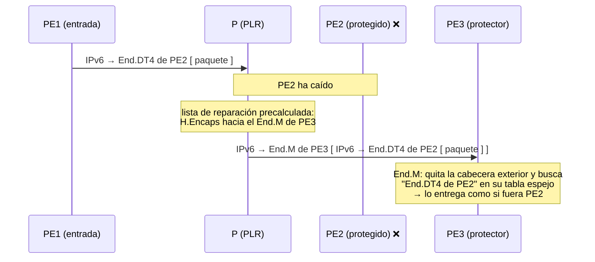

# Lo que FRR aún no hace (y dónde se explica en el curso)

> **Para qué sirve esta página**: el curso monta todo con software libre, FRR y el kernel de Linux, y es honesto con lo que no se puede montar: cada módulo y cada escenario cuenta sus carencias en su sitio. Aquí están **todas juntas**, con enlace a donde se explican, y cuatro temas que no tienen módulo propio: la protección del PE de salida, los *shortcuts*, el *slicing* con una cabecera Hop-by-Hop y la convivencia con MPLS.
>
> **Estado a octubre de 2026**: FRR 10.7.1 y kernel Linux 7.2 (el de los laboratorios). FRR avanza deprisa en SRv6: si encuentras que algo de esta lista ya funciona, merece la pena volver a mirarlo en las notas de cada versión.

## 1. Todo de un vistazo

✅ lo hay y se usa en el curso · ⚠️ lo hay a medias · ❌ no lo hay (el curso lo explica y, si puede, lo emula)

### Plano de datos (el kernel de Linux)

| Pieza | Linux | FRR la programa | En el curso |
|---|:-:|:-:|---|
| `End`, `End.X`, `End.T`, `End.DX4/DX6/DX2`, `End.DT4/DT6/DT46`, `H.Encaps`, `H.Encaps.Red`, `H.Encaps.L2` | ✅ | ✅ (las que usan IS-IS y BGP) | Módulos [08](../../08-network-programming/README.md) a [13](../../13-l3vpn-dualstack/README.md) |
| Flavors PSP, USP y USD | ✅ | — | Módulo [09](../../09-reduccion-cabeceras/README.md) |
| uSID: uN y uA (`next-csid`) | ✅ | ✅ (FRR ≥ 10.5) | Módulo [10](../../10-usid/README.md), escenario [E5](../E5-usid-migracion/README.md) |
| uDT46 | ⚠️ El kernel lo ejecuta como un `End.DT46` normal | ✅ | Escenario [E5](../E5-usid-migracion/README.md) |
| `End.DT2U` / `End.DT2M` (EVPN sobre SRv6) | ❌ | ❌ | Escenario [E3](../E3-evpn/README.md) (con `End.DX2`, que sí existe) |
| `End.Replicate` (segmentos de replicación) | ❌ | ❌ | Módulo [20](../../20-replication-segments/README.md) (emulado con un script) |
| BIER, BIERin6, `End.BIER` | ❌ | ❌ | Módulo [21](../../21-bier/README.md) (emulado con un script) |
| Proxies de funciones de servicio (`End.AS`, `End.AD`, `End.AM`) | ❌ | ❌ | Escenario [E6](../E6-sfc/README.md) (emulado con `End.DT4` y VRF) |
| `End.M` (protección del PE de salida) | ❌ | ❌ | [Sección 2](#2-protección-del-pe-de-salida-egress-protection) |
| `End.DTM`, `End.DXM*`, `H.Encaps.M` (convivencia con MPLS) | ❌ | ❌ | [Sección 5](#5-convivencia-con-mpls-interworking) |
| Opción NR (identificador de rebanada) en Hop-by-Hop | ❌ | ❌ | [Sección 4](#4-slicing-con-una-cabecera-hop-by-hop), escenario [E4](../E4-slicing/README.md) |

> **Un detalle del kernel que conviene saber.** Cuando una ruta con `encap seg6` encapsula un paquete reenviado, Linux vuelve a enrutar el paquete por su **destino exterior** (el primer segmento) e ignora el siguiente salto de la ruta. El camino lo decide la lista de segmentos, no el `via` de la ruta. Lo descubrimos en el escenario [E7](../E7-controlador/README.md).

### Plano de control (FRR)

| Pieza | FRR 10.7.1 | En el curso |
|---|:-:|---|
| IS-IS con SRv6: locators, `End` y `End.X` | ✅ | Módulo [11](../../11-isis-srv6/README.md) |
| L3VPN IPv4, IPv6 y dual-stack sobre SRv6 (BGP) | ✅ | Módulos [12](../../12-l3vpn-bgp/README.md) y [13](../../13-l3vpn-dualstack/README.md), escenarios [E1](../E1-multisede/README.md) y [E2](../E2-inter-as/README.md) |
| Tabla global sobre SRv6 (`sid export` y `encapsulation-srv6`) | ✅ | Escenario [E0](../E0-internet/README.md) |
| Rutas estáticas con segmentos (`staticd`), con pesos | ✅ | Escenarios [E0](../E0-internet/README.md), [E1](../E1-multisede/README.md), [E4](../E4-slicing/README.md) y [E7](../E7-controlador/README.md) |
| BGP-LS con las extensiones SRv6 (exportar la topología) | ✅ (FRR ≥ 10.7) | Escenario [E7](../E7-controlador/README.md) |
| Comunidad **Color** en las rutas VPN | ⚠️ El *route-map* de exportación se carga sin la cláusula `set` | Escenario [E1](../E1-multisede/README.md) |
| EVPN sobre SRv6 | ❌ Solo con VXLAN | Escenario [E3](../E3-evpn/README.md) |
| BGP MVPN (las hojas del multicast) | ❌ | Módulo [19](../../19-replicacion-ingreso/README.md) |

### Ingeniería de tráfico, resiliencia y *slicing*

| Pieza | FRR 10.7.1 | En el curso |
|---|:-:|---|
| **SR Policy** para SRv6 (`pathd`) | ❌ Solo SR-MPLS | Módulo [14](../../14-te-srv6/README.md), escenarios [E1](../E1-multisede/README.md), [E4](../E4-slicing/README.md) y [E7](../E7-controlador/README.md) (con estáticas con segmentos) |
| Programar una política SRv6 desde un controlador (PCEP o BGP SR Policy) | ❌ | Escenario [E7](../E7-controlador/README.md) (el controlador usa `vtysh`) |
| **Flex-Algo** con SRv6 | ❌ Solo SR-MPLS | Módulo [16](../../16-flex-algo/README.md) (teoría), escenario [E4](../E4-slicing/README.md) |
| **TI-LFA** con SRv6 | ❌ El TI-LFA de FRR es solo para SR-MPLS (con SRv6, 0 % de cobertura). LFA clásico sí protege el transporte | Módulo [15](../../15-tilfa/README.md) |
| Protección del PE de salida | ❌ | [Sección 2](#2-protección-del-pe-de-salida-egress-protection) |
| *Shortcuts* (el IGP usa una política como si fuera un enlace) | ❌ | [Sección 3](#3-shortcuts-el-igp-usa-una-política-como-un-enlace) |
| Reserva de recursos por rebanada | ❌ (no es cosa del protocolo de rutas) | Escenario [E4](../E4-slicing/README.md) |

### Multicast, servicios y convivencia

| Pieza | FRR 10.7.1 / Linux | En el curso |
|---|:-:|---|
| PIM e IGMP/MLD | ✅ (`pimd`, `pim6d`), pero no sobre SRv6 | Módulo [19](../../19-replicacion-ingreso/README.md) |
| Replicar multicast hacia encapsulados SRv6 | ❌ El kernel solo replica hacia interfaces | Módulo [19](../../19-replicacion-ingreso/README.md) (con un script) |
| SR P2MP Policy (árboles calculados por un PCE) | ❌ | Módulo [20](../../20-replication-segments/README.md) |
| BIER y su señalización en IS-IS | ❌ | Módulo [21](../../21-bier/README.md) |
| *Service chaining* con proxies SR | ❌ | Escenario [E6](../E6-sfc/README.md) |
| Convivencia SRv6 – MPLS | ❌ | [Sección 5](#5-convivencia-con-mpls-interworking) |

## 2. Protección del PE de salida (*egress protection*)

**El problema.** TI-LFA (módulo 15) protege los enlaces y los nodos **de tránsito** de un camino: si cae uno, el router anterior ya tiene preparada otra lista de segmentos. Pero no puede proteger el **último** nodo, el PE de salida. Si ese PE cae, el SID de servicio (`End.DT4`, `End.DT46`…) desaparece con él, y no hay otro camino hacia un SID que ya no existe. Mientras BGP no se entera de la caída y los PE de entrada cambian de ruta, el tráfico se pierde.

**La solución que se está estandarizando** ([draft-ietf-rtgwg-srv6-egress-protection](https://datatracker.ietf.org/doc/draft-ietf-rtgwg-srv6-egress-protection/), versión 26, de octubre de 2026) se basa en un **SID espejo** (*Mirror SID*, behavior **`End.M`**):

1. Otro PE de la misma sede, el **protector**, anuncia por el IGP: "protejo el locator del PE principal, y mi SID espejo es este".
2. El protector aprende por **BGP**, como cualquier PE, los SIDs de servicio del principal, y para cada uno prepara una entrada equivalente en el contexto de su SID espejo: "si llega algo para el `End.DT4` de PE2, lo trato como si fuera mío".
3. El penúltimo router del camino (el **PLR**) precalcula, como en TI-LFA, una lista de reparación que termina en el SID espejo del protector.
4. Si el PE principal cae, el PLR **encapsula** cada paquete con esa lista y lo envía al protector. Allí, `End.M` (una variante de `End.DT6`) quita la cabecera exterior y busca el SID de servicio original en la tabla espejo, que le dice qué hacer con el paquete.

**En FRR y Linux**: no hay `End.M`, ni el anuncio del protector en IS-IS. Lo más parecido que se puede montar es la convergencia normal de BGP: un PE de entrada con dos rutas hacia la misma sede (por PE2 y por PE3) que cambia a la segunda cuando IS-IS retira el locator de PE2. Funciona, pero en segundos, no en los milisegundos de una protección local.

## 3. *Shortcuts*: el IGP usa una política como un enlace

**La idea** viene del mundo MPLS-TE ([RFC 3906](https://www.rfc-editor.org/rfc/rfc3906)): un túnel de ingeniería de tráfico se presenta al IGP **como si fuera un enlace directo** entre su origen y su destino. Al calcular el SPF, el router de cabecera puede usar ese "enlace", y el tráfico hacia **cualquier destino que esté detrás** del extremo del túnel entra en él automáticamente, sin configurar destino por destino. Con Segment Routing, lo mismo se hace con una **SR Policy** (algunos fabricantes lo llaman *autoroute*).

La diferencia con lo que hacemos en el curso:

| | Estáticas con segmentos (el curso) | *Shortcut* |
|---|---|---|
| Qué tráfico entra en el camino | El de los prefijos que configuras uno a uno | Todo el que, según el SPF, pasa por el extremo de la política |
| Si aparece un prefijo nuevo detrás | Hay que añadir otra estática | Entra solo |
| Si la política cae | La estática sigue ahí (E7, parte F) | El IGP deja de usarla y vuelve al camino normal |

**En FRR**: sin SR Policy para SRv6 no hay nada que anunciar como *shortcut*. Las estáticas con segmentos (y, en el escenario E7, un controlador que las mantiene) son la aproximación que se puede montar.

## 4. *Slicing* con una cabecera Hop-by-Hop

En el escenario [E4](../E4-slicing/README.md), cada rebanada se identificaba por su SID de servicio y solo los PE sabían de ella. Para que **cada router** del camino pueda dar a cada rebanada sus recursos (su cola, su ancho de banda), el paquete tiene que decirle a qué rebanada pertenece. La propuesta del IETF es una opción en la cabecera de extensión **Hop-by-Hop**, la única que leen todos los routers del camino:

- **El documento**: [draft-ietf-6man-enhanced-vpn-vtn-id](https://datatracker.ietf.org/doc/draft-ietf-6man-enhanced-vpn-vtn-id/), versión 16, de junio de 2026. La opción se ha ido llamando VTN ID y NRP ID, y ahora **opción NR** (*Network Resource*).
- **Qué lleva**: un identificador de 4 bytes (el *NRP Selector ID*) y un indicador S (coincidencia estricta).
- **Cómo se usa**: la dirección de destino sigue decidiendo **por dónde** sale el paquete; el identificador decide **con qué recursos** de esa interfaz. Si el router no tiene esa rebanada configurada en la interfaz, el bit S dice si se descarta o va con los recursos por defecto.
- **El riesgo**: muchos routers tratan las cabeceras Hop-by-Hop por una vía lenta, o las descartan. El documento se apoya en el [RFC 9673](https://www.rfc-editor.org/rfc/rfc9673), que pide procesarlas sin penalizar el paquete, y recomienda usarlas solo dentro del dominio del operador.

**En Linux**: el kernel acepta paquetes con opciones Hop-by-Hop desconocidas (las salta, porque su tipo empieza por los bits `00`), pero no las interpreta ni asocia colas a un identificador. Se podría emular la parte de recursos con `tc`, clasificando por los bytes de la opción, pero ni FRR ni el kernel lo hacen solos.

## 5. Convivencia con MPLS (*interworking*)

Pocas redes pasan a SRv6 de golpe: durante años conviven trozos con MPLS (o SR-MPLS) y trozos con SRv6. El IETF lo trata en [draft-ietf-spring-srv6-mpls-interworking](https://datatracker.ietf.org/doc/draft-ietf-spring-srv6-mpls-interworking/) (versión 02, de febrero de 2026), que distingue dos problemas:

| Problema | Casos | Cómo se resuelve |
|---|---|---|
| **Transporte**: atravesar un dominio con el otro plano de datos | SRv6 sobre un núcleo MPLS (*6oM*) y MPLS sobre un núcleo SRv6 (*Mo6*) | En la frontera, encapsular un plano dentro del otro: **`H.Encaps.M`** mete una pila de etiquetas MPLS dentro de IPv6 (*Next Header* 137), y **`End.DTM`** la saca y busca la etiqueta en la tabla MPLS |
| **Servicio**: un PE con SRv6 y otro con MPLS en la misma VPN | De SRv6 a MPLS (*6toM*) y al revés (*Mto6*) | Un *gateway* traduce el SID de servicio en una etiqueta de servicio y al revés: **`End.DXM4`**, **`End.DXM6`** y **`End.DXM2`** desencapsulan y ponen la pila de etiquetas asociada al SID |

Para las islas SRv6 separadas por una red IPv4 sin SRv6, el escenario [E5](../E5-usid-migracion/README.md) explica la opción más sencilla: un túnel GRE.

**En FRR y Linux**: FRR tiene SR-MPLS y SRv6, pero no hace de *gateway* entre ellos, y el kernel no tiene ninguno de esos behaviors. El curso evita MPLS en los laboratorios a propósito, así que este tema se queda en la teoría.

## 6. Cómo seguir la evolución

- Las **notas de cada versión de FRR** ([github.com/FRRouting/frr/releases](https://github.com/FRRouting/frr/releases)) dicen qué entra en SRv6. Entre la 10.2 y la 10.7, por ejemplo, llegaron la tabla global sobre SRv6, los uSID con varios locators y BGP-LS con SRv6.
- El **kernel de Linux** incorpora behaviors SRv6 nuevos poco a poco; [segment-routing.net](https://segment-routing.net/open-software/linux) mantiene la lista de lo que hay.
- Cuando algo de esta página pase a funcionar, su módulo o escenario puede ganar un laboratorio: la tabla de la sección 1 dice exactamente dónde.

## Para saber más

- [draft-ietf-rtgwg-srv6-egress-protection · SRv6 Egress Protection](https://datatracker.ietf.org/doc/draft-ietf-rtgwg-srv6-egress-protection/)
- [RFC 3906 · Calculating IGP Routes Over Traffic Engineering Tunnels](https://www.rfc-editor.org/rfc/rfc3906)
- [RFC 9256 · Segment Routing Policy Architecture](https://www.rfc-editor.org/rfc/rfc9256)
- [draft-ietf-6man-enhanced-vpn-vtn-id · Carrying Network Resource Information in IPv6 Extension Headers](https://datatracker.ietf.org/doc/draft-ietf-6man-enhanced-vpn-vtn-id/)
- [RFC 9673 · IPv6 Hop-by-Hop Options Processing Procedures](https://www.rfc-editor.org/rfc/rfc9673)
- [draft-ietf-spring-srv6-mpls-interworking · SRv6 and MPLS Interworking](https://datatracker.ietf.org/doc/draft-ietf-spring-srv6-mpls-interworking/)
