# Topología base de los escenarios

Todos los escenarios del anexo usan **esta misma red**: un núcleo SRv6 de seis routers en malla parcial, con dos sedes de cliente en cada extremo. Cada escenario parte de una copia de este laboratorio, configura los servicios que necesita y, si hace falta, **añade equipos** en los puntos de enganche previstos. El núcleo nunca cambia, así que siempre reconocerás la red.

> **Estado: 🧪 escrita, pendiente de probar** en containerlab 0.74.3, FRR 10.2.1 y netshoot v0.13.

```mermaid
graph LR
    h1("🖥️ <b>h1</b><br/>PC1 · sede BLUE-1<br/>eth1: 192.168.10.12/24, 3fff:168:10::12/64")
    h11("🖥️ <b>h11</b><br/>PC11 · VLAN 100<br/>eth1: 192.168.100.11/24, 3fff:168:100::11/64")
    sw1("<b>sw1</b><br/>switch · VLAN 100 (Linux bridge)")
    r1("<b>r1</b><br/>PE1 · FRR<br/>lo: 3fff:0:ff::1/128<br/>eth1: 3fff:0:12::1/64 (m=10)<br/>eth2: 3fff:0:13::1/64 (m=15)<br/>eth3: → h1 · sede BLUE-1 (según escenario)<br/>eth4: → sw1 · VLAN 100 (según escenario)<br/>locator 5f00:0:1::/48<br/>SID End/End.X automáticos")
    r2("<b>r2</b><br/>P · FRR<br/>lo: 3fff:0:ff::2/128<br/>eth1: 3fff:0:12::2/64 (m=10)<br/>eth2: 3fff:0:23::2/64 (m=10)<br/>eth3: 3fff:0:24::2/64 (m=10)<br/>eth4: 3fff:0:25::2/64 (m=25)<br/>locator 5f00:0:2::/48<br/>SID End/End.X automáticos")
    r3("<b>r3</b><br/>P · FRR<br/>lo: 3fff:0:ff::3/128<br/>eth1: 3fff:0:13::3/64 (m=15)<br/>eth2: 3fff:0:23::3/64 (m=10)<br/>eth3: 3fff:0:35::3/64 (m=10)<br/>eth4: 3fff:0:34::3/64 (m=25)<br/>locator 5f00:0:3::/48<br/>SID End/End.X automáticos")
    r4("<b>r4</b><br/>P · FRR<br/>lo: 3fff:0:ff::4/128<br/>eth1: 3fff:0:24::4/64 (m=10)<br/>eth2: 3fff:0:45::4/64 (m=15)<br/>eth3: 3fff:0:46::4/64 (m=10)<br/>eth4: 3fff:0:34::4/64 (m=25)<br/>locator 5f00:0:4::/48<br/>SID End/End.X automáticos")
    r5("<b>r5</b><br/>P · FRR<br/>lo: 3fff:0:ff::5/128<br/>eth1: 3fff:0:35::5/64 (m=10)<br/>eth2: 3fff:0:45::5/64 (m=15)<br/>eth3: 3fff:0:56::5/64 (m=10)<br/>eth4: 3fff:0:25::5/64 (m=25)<br/>locator 5f00:0:5::/48<br/>SID End/End.X automáticos")
    r6("<b>r6</b><br/>PE2 · FRR<br/>lo: 3fff:0:ff::6/128<br/>eth1: 3fff:0:46::6/64 (m=10)<br/>eth2: 3fff:0:56::6/64 (m=10)<br/>eth3: → h2 · sede BLUE-2 (según escenario)<br/>eth4: → sw2 · VLAN 100 (según escenario)<br/>locator 5f00:0:6::/48<br/>SID End/End.X automáticos")
    sw2("<b>sw2</b><br/>switch · VLAN 100 (Linux bridge)")
    h2("🖥️ <b>h2</b><br/>PC2 · sede BLUE-2<br/>eth1: 192.168.20.12/24, 3fff:168:20::12/64")
    h12("🖥️ <b>h12</b><br/>PC12 · VLAN 100<br/>eth1: 192.168.100.12/24, 3fff:168:100::12/64")

    r1 -- "eth1 ⟷ eth1<br/>3fff:0:12::/64 · m=10" --- r2
    r1 -- "eth2 ⟷ eth1<br/>3fff:0:13::/64 · m=15" --- r3
    r2 -- "eth2 ⟷ eth2<br/>3fff:0:23::/64 · m=10" --- r3
    r2 -- "eth3 ⟷ eth1<br/>3fff:0:24::/64 · m=10" --- r4
    r2 -- "eth4 ⟷ eth4<br/>3fff:0:25::/64 · m=25" --- r5
    r3 -- "eth3 ⟷ eth1<br/>3fff:0:35::/64 · m=10" --- r5
    r3 -- "eth4 ⟷ eth4<br/>3fff:0:34::/64 · m=25" --- r4
    r4 -- "eth2 ⟷ eth2<br/>3fff:0:45::/64 · m=15" --- r5
    r4 -- "eth3 ⟷ eth1<br/>3fff:0:46::/64 · m=10" --- r6
    r5 -- "eth3 ⟷ eth2<br/>3fff:0:56::/64 · m=10" --- r6
    h1 -- "eth1 ⟷ eth3<br/>192.168.10.0/24" --- r1
    sw1 -- "eth1 ⟷ eth4" --- r1
    h11 -- "eth1 ⟷ eth2<br/>192.168.100.0/24" --- sw1
    r6 -- "eth3 ⟷ eth1<br/>192.168.20.0/24" --- h2
    r6 -- "eth4 ⟷ eth1" --- sw2
    sw2 -- "eth2 ⟷ eth1<br/>192.168.100.0/24" --- h12

    classDef router fill:#ddf4ff,stroke:#0969da,stroke-width:2px,color:#1f2328
    classDef host fill:#dafbe1,stroke:#1a7f37,stroke-width:2px,color:#1f2328
    classDef switch fill:#f6f8fa,stroke:#57606a,stroke-width:2px,color:#1f2328
    class r1,r2,r3,r4,r5,r6 router
    class h1,h11,h2,h12 host
    class sw1,sw2 switch
```

<!-- topologia:inicio -->

<!-- topologia:fin -->

> El fichero editable para draw.io está en [`lab/topologia.drawio`](lab/topologia.drawio).

## Roles

| Equipo | Rol | Qué hace |
|---|---|---|
| **r1**, **r6** | PE | Bordes del operador: conectan las sedes de cliente y ejecutan los servicios (VRF, EVPN, Internet…) |
| **r2**, **r3**, **r4**, **r5** | P | Núcleo: solo transporte SRv6 (IS-IS, locators, End/End.X) |
| **h1**, **h2** | Hosts | Sedes **BLUE-1** y **BLUE-2** (servicios de capa 3) |
| **h11**, **h12** | Hosts | Sedes de la **VLAN 100** (servicios de capa 2) |
| **sw1**, **sw2** | Switches | Bridge de Linux entre el PE y los hosts de la VLAN 100 |

Todo el núcleo es un único dominio **IS-IS de nivel 2** (`CORE`) con **SRv6**: cada router anuncia su locator `5f00:0:N::/48` y FRR instala sus SIDs `End` y `End.X`. Las interfaces de borde de los PE (`eth3` hacia BLUE y `eth4` hacia la VLAN 100) se entregan **sin configurar**: cada escenario las configura según su servicio.

## Enlaces y métricas

Las métricas IS-IS están elegidas para que el **camino más corto entre cualquier par de routers sea único** (sin ECMP). Así, cuando un escenario fuerce otro camino, o cuando caiga un enlace, se verá con claridad.

| Enlace | Subred | Métrica |
|---|---|:-:|
| r1 `eth1` ⟷ r2 `eth1` | `3fff:0:12::/64` | 10 |
| r1 `eth2` ⟷ r3 `eth1` | `3fff:0:13::/64` | 15 |
| r2 `eth2` ⟷ r3 `eth2` | `3fff:0:23::/64` | 10 |
| r2 `eth3` ⟷ r4 `eth1` | `3fff:0:24::/64` | 10 |
| r2 `eth4` ⟷ r5 `eth4` (diagonal) | `3fff:0:25::/64` | 25 |
| r3 `eth3` ⟷ r5 `eth1` | `3fff:0:35::/64` | 10 |
| r3 `eth4` ⟷ r4 `eth4` (diagonal) | `3fff:0:34::/64` | 25 |
| r4 `eth2` ⟷ r5 `eth2` | `3fff:0:45::/64` | 15 |
| r4 `eth3` ⟷ r6 `eth1` | `3fff:0:46::/64` | 10 |
| r5 `eth3` ⟷ r6 `eth2` | `3fff:0:56::/64` | 10 |

Caminos de **r1 a r6**, de menor a mayor coste:

| Coste | Camino | Papel habitual en los escenarios |
|:-:|---|---|
| **30** | r1 → r2 → r4 → r6 | **Primario** (el que elige IS-IS) |
| 35 | r1 → r3 → r5 → r6 | Alternativo por abajo, disjunto del primario |
| 40 | r1 → r2 → r3 → r5 → r6 | |
| 45 | r1 → r2 → r4 → r5 → r6 · r1 → r2 → r5 → r6 · r1 → r3 → r2 → r4 → r6 | Caminos "retorcidos" para ingeniería de tráfico |

> **Nombres de interfaz.** Si vienes del esquema original con nomenclatura tipo IOS-XR, la equivalencia es `ethN` = `G0/0/0/(N-1)`: `eth1` es `G0/0/0/0`, `eth2` es `G0/0/0/1`, etc.

## Plan de direccionamiento

| Qué | Bloque | Ejemplo |
|---|---|---|
| Loopbacks | `3fff:0:ff::N/128` | r4 → `3fff:0:ff::4` |
| Enlaces de núcleo | `3fff:0:XY::/64` (X < Y) | r2–r5 → `3fff:0:25::2` y `::5` |
| Locators SRv6 | `5f00:0:N::/48` ([RFC 9602](https://www.rfc-editor.org/rfc/rfc9602)) | r6 → `5f00:0:6::/48` |
| Sede BLUE-1 (h1) | `192.168.10.0/24` · `3fff:168:10::/64` | h1 → `.12` / `::12`, puerta de enlace en r1 `.1` / `::1` |
| Sede BLUE-2 (h2) | `192.168.20.0/24` · `3fff:168:20::/64` | h2 → `.12` / `::12`, puerta de enlace en r6 `.1` / `::1` |
| VLAN 100 (h11, h12) | `192.168.100.0/24` · `3fff:168:100::/64` | h11 → `.11`, h12 → `.12` (mismo dominio de capa 2) |
| AS del operador | **64500** ([RFC 5398](https://www.rfc-editor.org/rfc/rfc5398), ASN de documentación) | |
| Redes "públicas" de terceros | `192.0.2.0/24`, `198.51.100.0/24`, `203.0.113.0/24` ([RFC 5737](https://www.rfc-editor.org/rfc/rfc5737)) y `3fff::/20` | Internet y otros operadores (E0, E2) |

Las sedes usan direcciones privadas IPv4 (como un cliente real) y `3fff::/20` en IPv6, el bloque de documentación que usa todo el curso.

## Puntos de enganche previstos

Los escenarios que necesitan más equipos los conectan siempre en el mismo sitio:

| Interfaz | Equipo que se añade | Escenarios |
|---|---|---|
| r6 `eth5` | Router **Internet** (upstream, eBGP) | E0 |
| r6 `eth6` | Segundo AS (**64501**), con dos routers | E2 |
| r5 `eth5` | **Tercera sede** (BLUE-3 o VLAN 100) | E1, E6 |
| r4 `eth5` | **Función de servicio** (un firewall en contenedor) | E9 |

Si un escenario necesita otro enganche, se documenta en él y se añade a esta tabla.

## Probar la topología base

```
$ cd anexo-escenarios/topologia-base/lab
$ sudo containerlab deploy -t lab.clab.yml
$ ./verificar.sh
$ sudo containerlab destroy -t lab.clab.yml --cleanup
```

`verificar.sh` comprueba las adyacencias IS-IS de los 10 enlaces, que cada router tenga su SID `End` y conozca los locators de los demás, el camino primario r1 → r2 → r4 → r6 y que las sedes estén cableadas. La base **no** transporta tráfico de cliente: eso lo hace cada escenario.

## Crear un escenario a partir de la base

```
$ cp -R anexo-escenarios/topologia-base/lab anexo-escenarios/E0-internet/lab
```

Después, en la copia:

1. Cambia `name: esc-base` por el del escenario (`esc-e0`, `esc-e1`…) en `lab.clab.yml` y `L=clab-esc-base` en `verificar.sh`.
2. Añade la configuración del servicio en los PE y los equipos nuevos en los enganches previstos.
3. Regenera el diagrama: `python3 herramientas/topologia.py anexo-escenarios/E0-internet/lab/lab.clab.yml`.

La [plantilla de escenario](../plantilla-escenario/README.md) tiene la estructura del texto.
